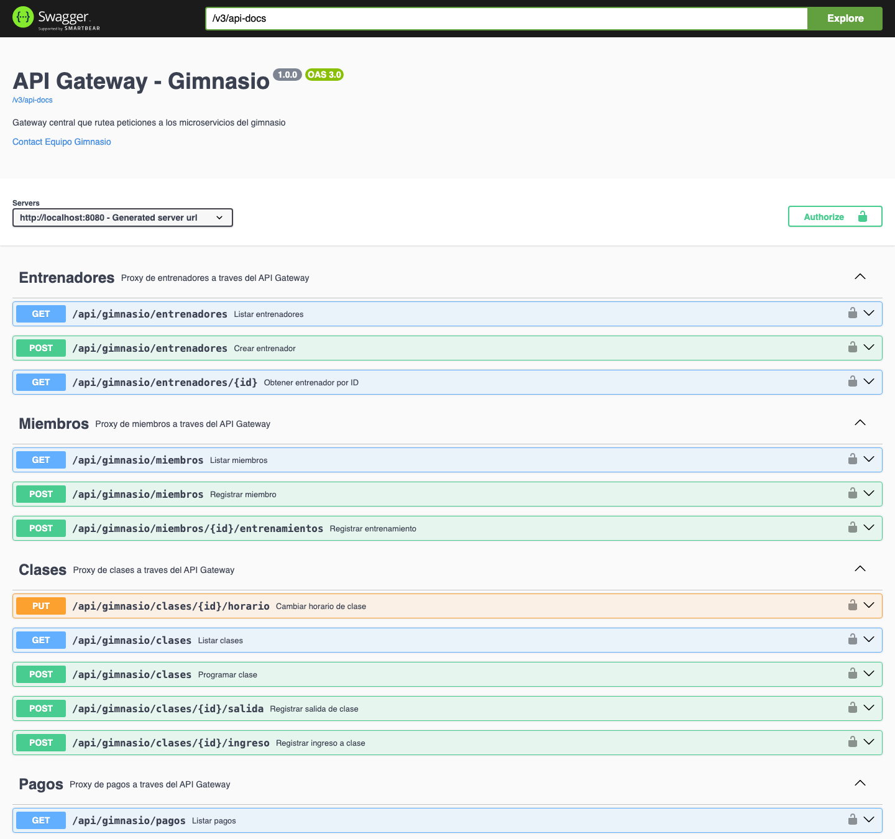
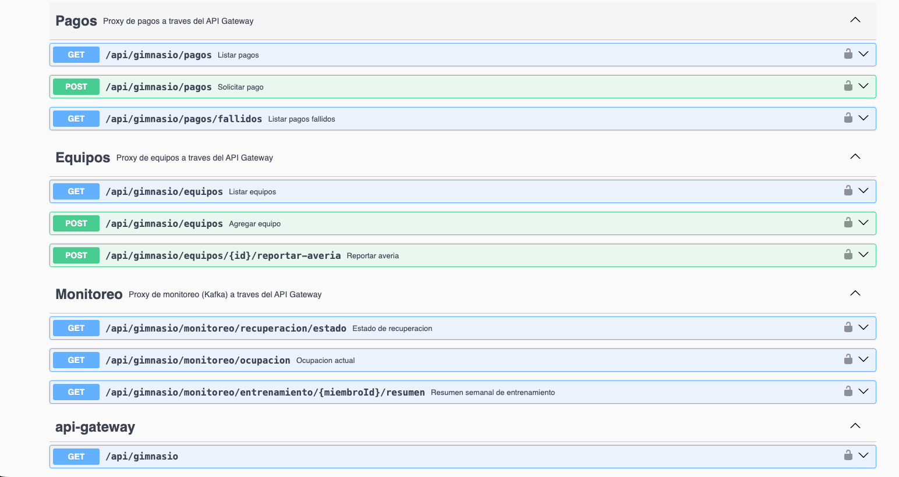
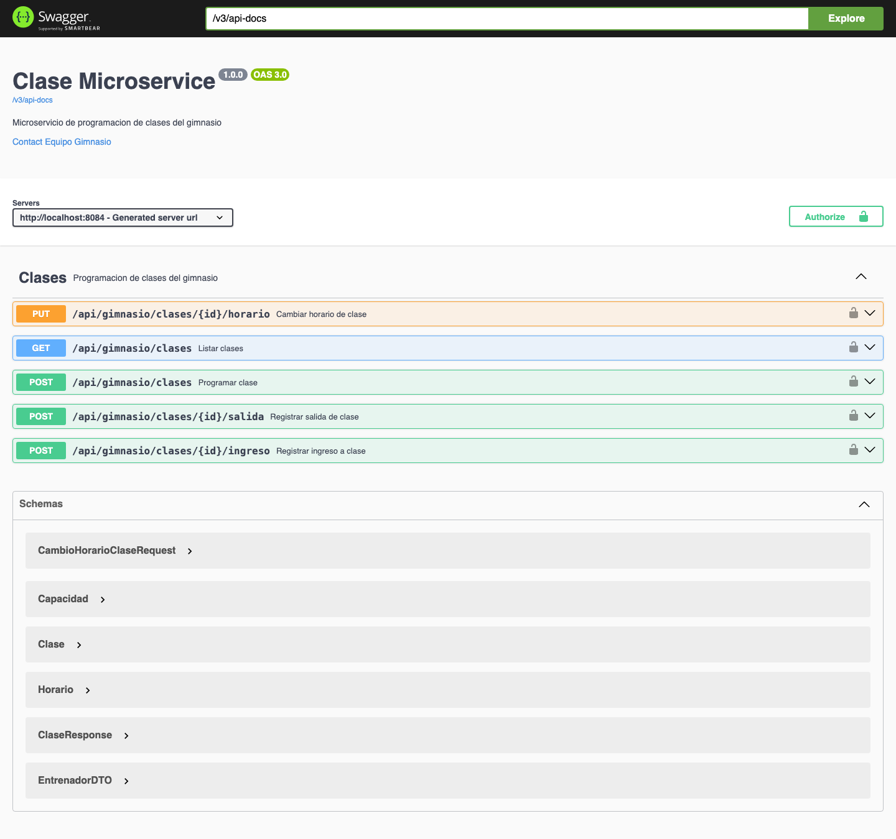
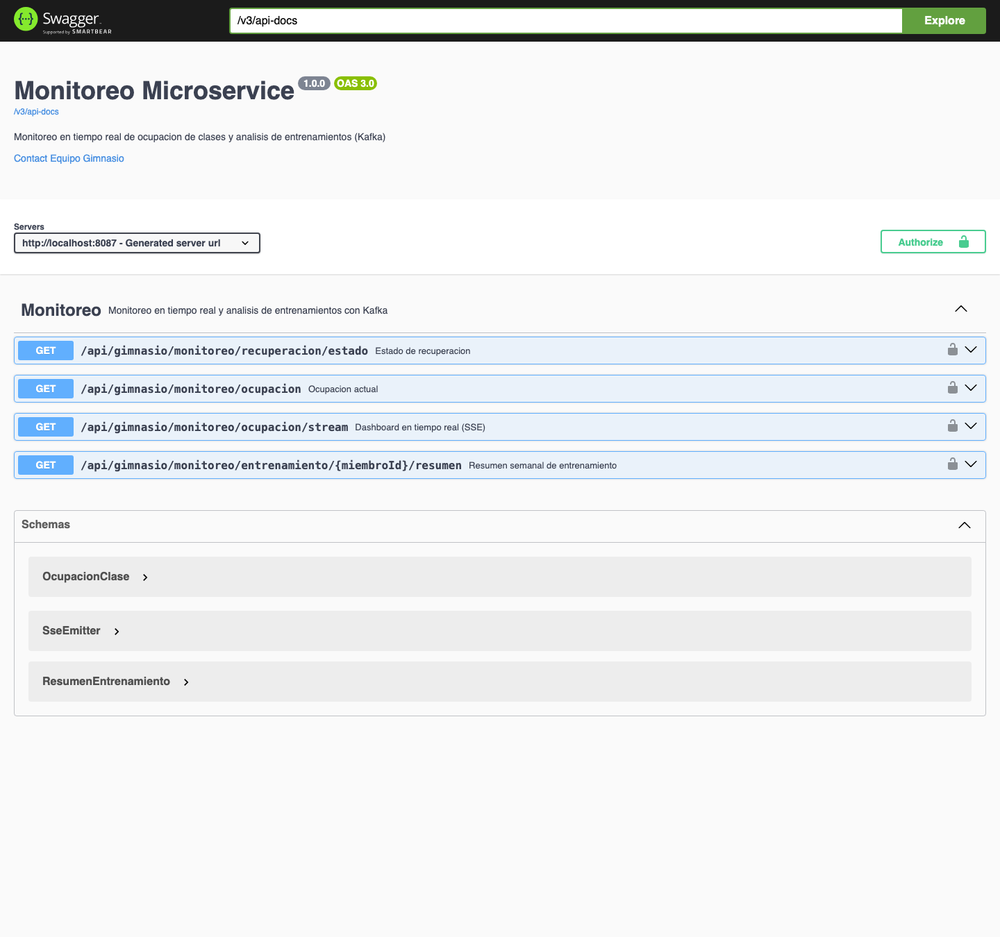
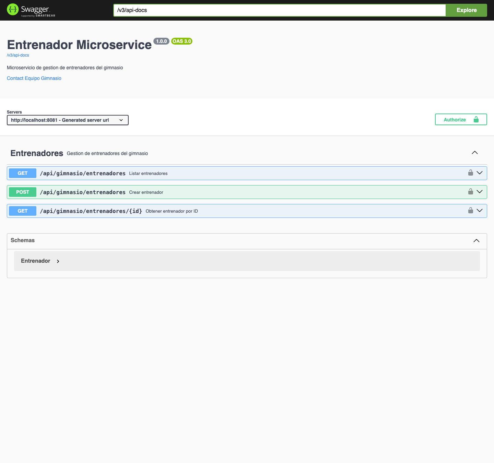
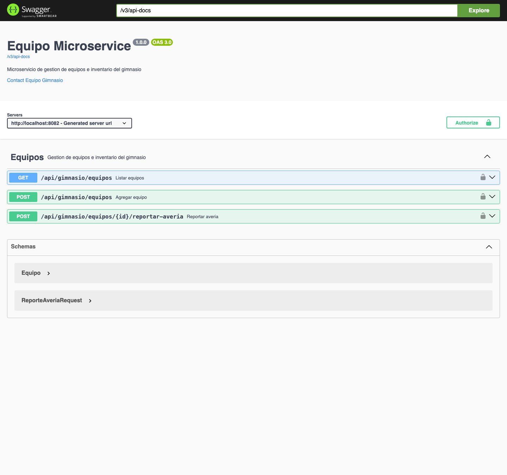
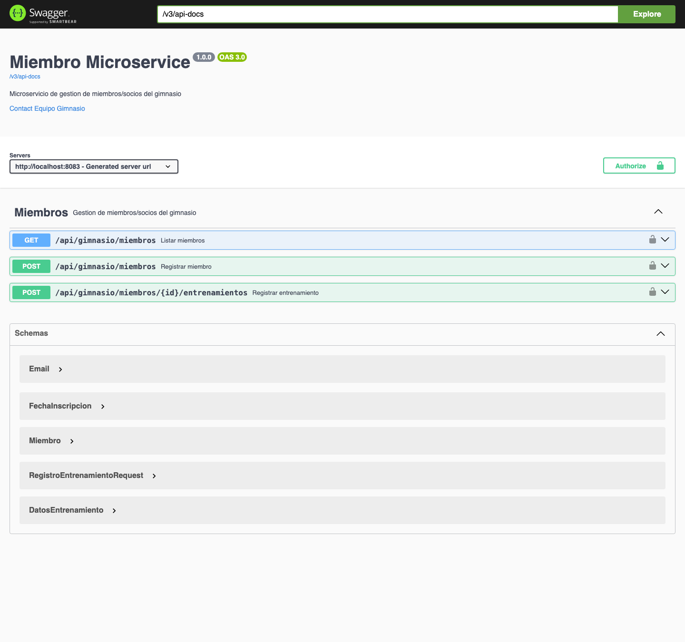
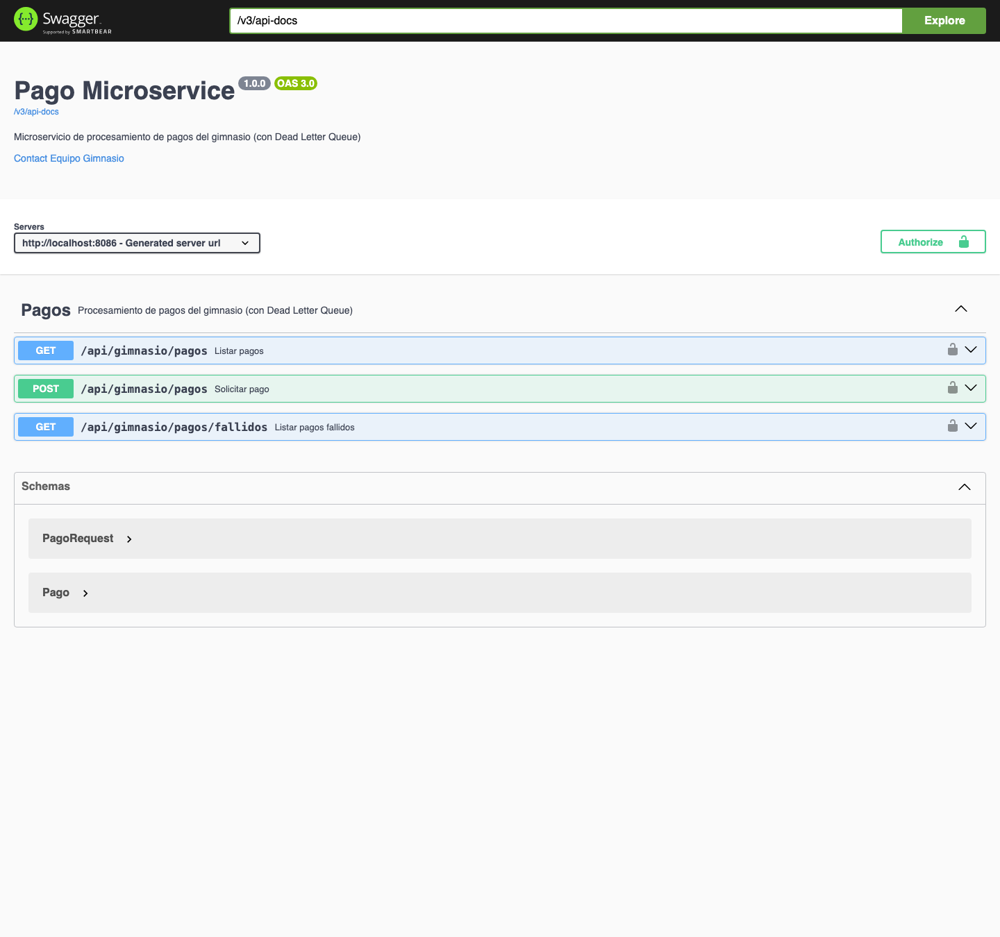

# Gimnasio - Arquitectura de Microservicios

Sistema distribuido de gestión de gimnasio construido con **Spring Boot 3.3.2**, **Spring Cloud 2023.0.3** y **Java 17**, refactorizado desde un monolito hacia una arquitectura de microservicios con **Spring Cloud Gateway (Reactivo)**, **Netflix Eureka**, **Keycloak (OAuth2/JWT)**, **RabbitMQ**, **Apache Kafka (KRaft) + Kafka Streams** y **Domain-Driven Design (DDD)**.

## Equipo

1. Daniel Jose Plazas Cortes - A00400085
2. Rony Farid Ordoñez García - A00397968
3. Daniel Gonzales Rivera - A00399873
4. Juan Pablo Parra Betancourt - A00

---

## Índice de Documentación

| Documento | Contenido |
|---|---|
| [`doc/01-ARQUITECTURA.md`](doc/01-ARQUITECTURA.md) | Visión general, diagrama de arquitectura, patrones de comunicación y modelo de dominio (DDD) |
| [`doc/02-API-GATEWAY.md`](doc/02-API-GATEWAY.md) | **API Gateway con Spring Cloud Gateway**: enrutamiento YAML/Java, Eureka, LoadBalancer, agregación reactiva y guion de sustentación |
| [`doc/03-SEGURIDAD.md`](doc/03-SEGURIDAD.md) | Seguridad OAuth2/JWT con Keycloak, forwarding de tokens y matriz de permisos RBAC |
| [`doc/04-API-REFERENCE.md`](doc/04-API-REFERENCE.md) | Referencia completa de todos los endpoints REST, DTOs, validaciones y respuestas |
| [`doc/05-MENSAJERIA.md`](doc/05-MENSAJERIA.md) | RabbitMQ (Direct, Fanout Pub/Sub, DLQ) y Apache Kafka (SSE, Kafka Streams y recuperación por checkpoints) |
| [`doc/RABBITMQ_Y_DLQ_GUIA.md`](doc/RABBITMQ_Y_DLQ_GUIA.md) | Guía teórica y práctica detallada de RabbitMQ y Dead Letter Queue |
| [`postman/GUIA_PRUEBAS_POSTMAN.md`](postman/GUIA_PRUEBAS_POSTMAN.md) | Guía paso a paso para ejecutar las 60 pruebas automatizadas en Postman |
| [`doc/Deployment Diagram.pdf`](doc/Deployment%20Diagram.pdf) | Diagrama de despliegue del sistema |

---

## Arquitectura

| Servicio                  | Puerto | Dominio                 |
| ------------------------- | ------ | ----------------------- |
| `api-gateway`             | 8080   | Spring Cloud Gateway (Reactivo, WebFlux + LoadBalancer + Agregación) |
| `eureka-server`           | 8761   | Registro y descubrimiento de servicios (Netflix Eureka) |
| `entrenador-microservice` | 8081   | Gestión de entrenadores |
| `equipo-microservice`     | 8082   | Inventario y averías    |
| `miembro-microservice`    | 8083   | Gestión de miembros     |
| `clase-microservice` (`x2`)| 8084 / 8088 | Programación de clases (2 instancias para balanceo Round-Robin) |
| `notificacion-microservice`| 8085  | Consumidor de eventos / Notificaciones |
| `pago-microservice`       | 8086   | Procesamiento de pagos (con Dead Letter Queue) |
| `monitoreo-microservice`  | 8087   | Monitoreo en tiempo real y análisis de entrenamientos (Kafka) |
| `RabbitMQ`                | 5672 / 15672 | Message Broker & Dashboard UI |
| `Kafka` (KRaft)           | 29092 (host) / 9092 (red interna) | Streaming de eventos |
| `Keycloak`                | 8180   | Proveedor de identidad (IAM), autenticación JWT |

### Comunicación entre Servicios
- **Enrutamiento, Descubrimiento y Composición (Spring Cloud Gateway + Eureka)**:
  1. **Enrutamiento declarativo y programático**: 5 rutas en [`application.yml`](services/api-gateway/src/main/resources/application.yml) y 1 ruta programática (`ruta-equipos-programatica`) en [`GatewayRoutesConfig.java`](services/api-gateway/src/main/java/co/analisys/gimnasio/config/GatewayRoutesConfig.java) usando nombres de servicio (`lb://<servicio>`).
  2. **Balanceo de carga**: `Spring Cloud LoadBalancer` resuelve las instancias en `eureka-server` (`:8761`) y reparte tráfico en Round-Robin entre `clase-service` (`:8084`) y `clase-service-2` (`:8088`).
  3. **Agregación de respuestas**: `GET /api/gimnasio/agregacion/miembro/{id}` ([`ResumenMiembroAggregationController.java`](services/api-gateway/src/main/java/co/analisys/gimnasio/controller/ResumenMiembroAggregationController.java)) consulta en paralelo (`Mono.zip`) a `miembro-service`, `clase-service` y `pago-service`.
- **Síncrona (REST)**: `clase-service` consulta a `entrenador-service` para validar y enriquecer la respuesta de clases con los datos del instructor asignado.
- **Asíncrona (RabbitMQ)**:
  1. **Notificación de Inscripción (Direct Exchange)**: `miembro-microservice` emite `MiembroInscritoEvent` a `gimnasio.miembro.exchange` con routing key `miembro.inscrito`. `notificacion-microservice` procesa el evento y envía el correo de bienvenida.
  2. **Difusión de Averías y Cambios de Horario (Fanout Exchange - Pub/Sub)**: `equipo-microservice` (`gimnasio.equipo.events`) y `clase-microservice` (`gimnasio.clase.horario.events`) difunden cada evento en simultáneo a 3 colas de `notificacion-microservice`.
  3. **Pagos con Dead Letter Queue**: `pago-microservice` recibe el pago (`202 Accepted`, estado `PENDIENTE`) y publica `PagoSolicitadoEvent` a `gimnasio.pagos.exchange` (routing key `pago.procesar`). El consumidor reintenta hasta 3 veces con backoff exponencial (1s, 2s) ante fallos de pasarela (`PagoRechazadoException`) y desvía los fallos definitivos a `gimnasio.pagos.dlx` → `pagos.procesamiento.dlq`.
- **Streaming (Kafka)**:
  1. **Ocupación de clases en tiempo real**: `clase-microservice` publica `OcupacionClase` en `ocupacion-clases` (key = `claseId`) en cada ingreso/salida. `monitoreo-microservice` (grupo `monitoreo-grupo`) actualiza el dashboard y lo emite por SSE.
  2. **Análisis de entrenamientos (Kafka Streams)**: `miembro-microservice` publica `DatosEntrenamiento` en `datos-entrenamiento` (key = `miembroId`). Un stream processor agrega por miembro en ventanas de 7 días (`resumen-entrenamiento-store`) y publica en `resumen-entrenamiento`.
  3. **Recuperación ante fallos**: un consumidor propio (`recuperacion-grupo`) procesa ambos topics guardando el resultado y el offset en la misma transacción (H2 en archivo). Al reiniciar hace `seek` al último checkpoint.

## Estructura del repo

```text
services/
  api-gateway/
  eureka-server/
  clase-microservice/
  entrenador-microservice/
  equipo-microservice/
  miembro-microservice/
  notificacion-microservice/
  pago-microservice/
  monitoreo-microservice/
doc/                   # Documentación completa de arquitectura, gateway, seguridad, API y mensajería
postman/               # Colección Postman (60 requests), entorno y guía de pruebas
keycloak/realm/        # Realm JSON para importación automática en Keycloak
pom.xml                # Aggregator Maven (9 módulos)
docker-compose.yml     # Orquesta Eureka + Gateway + microservicios + RabbitMQ + Keycloak + Kafka
```

## Cómo correr

**Con Docker Compose (recomendado para demo):**

```bash
docker compose up --build
```
> - **Guía paso a paso en Postman:** Ver [`postman/GUIA_PRUEBAS_POSTMAN.md`](postman/GUIA_PRUEBAS_POSTMAN.md).
> - **Dashboard de Eureka:** `http://localhost:8761`
> - **Rutas del API Gateway (Actuator):** `http://localhost:8080/actuator/gateway/routes`
> - **Panel web de RabbitMQ:** `http://localhost:15672` (`guest` / `guest`).
> - **Keycloak Admin:** `http://localhost:8180` (`admin` / `admin`). El realm `gimnasio` se importa automáticamente.

**Obtener token JWT para pruebas:**
```bash
curl -X POST http://localhost:8180/realms/gimnasio/protocol/openid-connect/token \
  -d "grant_type=password" \
  -d "client_id=gimnasio-gateway" \
  -d "username=admin" \
  -d "password=admin123"
```
> Usar el `access_token` del response como header: `Authorization: Bearer <token>`.

**Usuarios de prueba:**

| Usuario | Contraseña | Roles |
|---------|-----------|-------|
| `admin` | `admin123` | ROLE_ADMIN |
| `entrenador1` | `trainer123` | ROLE_TRAINER |
| `miembro1` | `member123` | ROLE_MEMBER |

## Probar API Gateway, Balanceo de Carga y Agregación

> Ver explicación detallada y guion de sustentación en [`doc/02-API-GATEWAY.md`](doc/02-API-GATEWAY.md).

```bash
# 1. Consultar rutas activas en Spring Cloud Gateway (YAML + Java RouteLocator)
curl http://localhost:8080/actuator/gateway/routes | python3 -m json.tool

# 2. Consultar resumen agregado de un miembro (Miembro + Clases + Pagos en paralelo con Mono.zip)
curl -H "Authorization: Bearer $ADMIN_TOKEN" http://localhost:8080/api/gimnasio/agregacion/miembro/1 | python3 -m json.tool
```

## Swagger / OpenAPI

Cada microservicio de negocio expone documentación interactiva:

| Servicio | Swagger UI |
|---|---|
| Entrenador | `http://localhost:8081/swagger-ui.html` |
| Equipo | `http://localhost:8082/swagger-ui.html` |
| Miembro | `http://localhost:8083/swagger-ui.html` |
| Clase | `http://localhost:8084/swagger-ui.html` |
| Pago | `http://localhost:8086/swagger-ui.html` |
| Monitoreo | `http://localhost:8087/swagger-ui.html` |

> Los endpoints protegidos requieren un token JWT. En Swagger UI, clic en "Authorize" y pegar el token obtenido de Keycloak.

## Pruebas de Seguridad (Keycloak + Roles JWT)

> Ver la matriz completa de permisos RBAC en [`doc/03-SEGURIDAD.md`](doc/03-SEGURIDAD.md).

```bash
# 1. Obtener tokens para cada rol
ADMIN_TOKEN=$(curl -s -X POST http://localhost:8180/realms/gimnasio/protocol/openid-connect/token \
  -d "grant_type=password" -d "client_id=gimnasio-gateway" \
  -d "username=admin" -d "password=admin123" | python3 -c "import sys,json; print(json.load(sys.stdin)['access_token'])")

TRAINER_TOKEN=$(curl -s -X POST http://localhost:8180/realms/gimnasio/protocol/openid-connect/token \
  -d "grant_type=password" -d "client_id=gimnasio-gateway" \
  -d "username=entrenador1" -d "password=trainer123" | python3 -c "import sys,json; print(json.load(sys.stdin)['access_token'])")

MEMBER_TOKEN=$(curl -s -X POST http://localhost:8180/realms/gimnasio/protocol/openid-connect/token \
  -d "grant_type=password" -d "client_id=gimnasio-gateway" \
  -d "username=miembro1" -d "password=member123" | python3 -c "import sys,json; print(json.load(sys.stdin)['access_token'])")

# 2. Token válido con rol autorizado -> 200 OK
curl -i -H "Authorization: Bearer $ADMIN_TOKEN" http://localhost:8080/api/gimnasio/clases

# 3. Token inválido o ausente -> 401 Unauthorized
curl -i -H "Authorization: Bearer token.invalido.123" http://localhost:8080/api/gimnasio/clases

# 4. Autorización por roles -> 403 Forbidden cuando el rol no tiene permiso
# MEMBER intentando listar miembros (solo permitido a ADMIN y TRAINER) -> 403 Forbidden
curl -i -H "Authorization: Bearer $MEMBER_TOKEN" http://localhost:8080/api/gimnasio/miembros

# TRAINER intentando crear un entrenador (solo permitido a ADMIN) -> 403 Forbidden
curl -i -X POST http://localhost:8080/api/gimnasio/entrenadores \
  -H "Authorization: Bearer $TRAINER_TOKEN" -H "Content-Type: application/json" \
  -d '{"nombre": "Pedro Gómez", "especialidad": "Crossfit"}'
```

## Probar Flujos Asincrónicos (RabbitMQ)

> **Guía teórica y práctica completa de RabbitMQ y Dead Letter Queue (DLQ):** Ver [`doc/RABBITMQ_Y_DLQ_GUIA.md`](doc/RABBITMQ_Y_DLQ_GUIA.md).
> Todos los endpoints (excepto `GET /api/gimnasio`) requieren autenticación JWT.
> Agregar el header `Authorization: Bearer <token>` a cada request, o usar Swagger UI con "Authorize".

### 1. Inscripción de Miembro (Direct Exchange -> Notificación de bienvenida)
```bash
# Obtener token (reutilizar TOKEN en todos los ejemplos)
TOKEN=$(curl -s -X POST http://localhost:8180/realms/gimnasio/protocol/openid-connect/token \
  -d "grant_type=password" -d "client_id=gimnasio-gateway" \
  -d "username=admin" -d "password=admin123" | python3 -c "import sys,json; print(json.load(sys.stdin)['access_token'])")

curl -X POST http://localhost:8080/api/gimnasio/miembros \
  -H "Authorization: Bearer $TOKEN" \
  -H "Content-Type: application/json" \
  -d '{"nombre": "Carlos Mendoza", "email": "carlos@gmail.com", "fechaInscripcion": "2026-09-14"}'
```
*Ver en la consola de `notificacion-service` el log con el envío del correo de bienvenida.*

### 2. Patrón Publish/Subscribe (Fanout Exchange -> 3 colas en simultáneo)
```bash
# Opción A: Cambio de horario de clase (notifica a App Móvil, Emailing y Auditoría)
curl -X PUT http://localhost:8080/api/gimnasio/clases/1/horario \
  -H "Authorization: Bearer $TOKEN" \
  -H "Content-Type: application/json" \
  -d '{"nuevoHorario": "2026-09-28T18:30:00", "motivo": "Cambio de salón principal"}'

# Opción B: Reporte de avería de equipo (notifica a Mantenimiento, Entrenadores y App Socios)
curl -X POST http://localhost:8080/api/gimnasio/equipos/1/reportar-averia \
  -H "Authorization: Bearer $TOKEN" \
  -H "Content-Type: application/json" \
  -d '{"motivo": "Fallo en motor de tracción y banda rota", "gravedad": "ALTA"}'
```
*Ver en la consola de `notificacion-service` los 3 logs procesados simultáneamente para cada evento.*

### 3. Pagos y Dead Letter Queue
```bash
# Aprobado: 1 intento
curl -X POST http://localhost:8080/api/gimnasio/pagos \
  -H "Authorization: Bearer $TOKEN" \
  -H "Content-Type: application/json" \
  -d '{"miembroId": 1, "monto": 120000, "metodoPago": "TARJETA"}'

# Rechazado por la pasarela: 3 intentos (1s, 2s) y luego a la DLQ
curl -X POST http://localhost:8080/api/gimnasio/pagos \
  -H "Authorization: Bearer $TOKEN" \
  -H "Content-Type: application/json" \
  -d '{"miembroId": 1, "monto": 120000, "metodoPago": "TARJETA_RECHAZADA"}'

# Inválido: sin reintentos, directo a la DLQ
curl -X POST http://localhost:8080/api/gimnasio/pagos \
  -H "Authorization: Bearer $TOKEN" \
  -H "Content-Type: application/json" \
  -d '{"miembroId": 1, "monto": -5000, "metodoPago": "EFECTIVO"}'

# Consultar estado (solo ADMIN)
curl -H "Authorization: Bearer $TOKEN" http://localhost:8080/api/gimnasio/pagos
curl -H "Authorization: Bearer $TOKEN" http://localhost:8080/api/gimnasio/pagos/fallidos
```
*En la consola de `pago-service` se ven los intentos, el `Retries exhausted` y el log `[DEAD LETTER QUEUE]` con la cabecera `x-death` (cola de origen y razón `rejected`).*

**Ver los mensajes dentro de la DLQ en el panel de RabbitMQ:** por defecto el consumidor de la DLQ los procesa al instante. Para que se queden en la cola, levantar `pago-service` con el consumidor pausado:
```bash
PAGO_DLQ_CONSUMIDOR_ACTIVO=false docker-compose up -d pago-service
```
Luego en `http://localhost:15672` → *Queues* → `pagos.procesamiento.dlq` → *Get messages*. Los pagos quedan en `PENDIENTE` con `intentos` y `motivoFallo` registrados. Al volver a `true` el consumidor vacía la DLQ (el reinicio borra la base H2 en memoria, así que esos pagos ya no aparecen en `/pagos`).

## Probar Streaming (Kafka)

### 1. Ocupación de clases en tiempo real
```bash
# Terminal 1: dashboard en vivo (SSE directo a monitoreo-service; el gateway no reenvía streams)
curl -N -H "Authorization: Bearer $TOKEN" http://localhost:8087/api/gimnasio/monitoreo/ocupacion/stream

# Terminal 2: generar movimiento en la clase 1
curl -X POST -H "Authorization: Bearer $TOKEN" http://localhost:8080/api/gimnasio/clases/1/ingreso
curl -X POST -H "Authorization: Bearer $TOKEN" http://localhost:8080/api/gimnasio/clases/1/ingreso
curl -X POST -H "Authorization: Bearer $TOKEN" http://localhost:8080/api/gimnasio/clases/1/salida

# Foto actual del dashboard
curl -H "Authorization: Bearer $TOKEN" http://localhost:8080/api/gimnasio/monitoreo/ocupacion
```
*La terminal 1 recibe un evento `ocupacion` por cada cambio. En la consola de `monitoreo-service` aparece el log `[DASHBOARD]`.*

### 2. Análisis de entrenamientos (Kafka Streams)
```bash
curl -X POST http://localhost:8080/api/gimnasio/miembros/1/entrenamientos \
  -H "Authorization: Bearer $TOKEN" -H "Content-Type: application/json" \
  -d '{"tipo": "CARDIO", "duracionMinutos": 45, "calorias": 400}'
curl -X POST http://localhost:8080/api/gimnasio/miembros/1/entrenamientos \
  -H "Authorization: Bearer $TOKEN" -H "Content-Type: application/json" \
  -d '{"tipo": "FUERZA", "duracionMinutos": 60, "calorias": 350}'

# Resumen semanal (consulta interactiva al state store); esperar ~1s al commit de Streams
curl -H "Authorization: Bearer $TOKEN" http://localhost:8080/api/gimnasio/monitoreo/entrenamiento/1/resumen

# Ver el topic de salida
docker exec gimnasio-kafka /opt/kafka/bin/kafka-console-consumer.sh --bootstrap-server localhost:9092 \
  --topic resumen-entrenamiento --from-beginning --property print.key=true
```

### 3. Recuperación ante fallos (checkpoints)
```bash
# 1. Estado inicial: checkpoints por partición y eventos procesados (solo ADMIN)
curl -H "Authorization: Bearer $TOKEN" http://localhost:8080/api/gimnasio/monitoreo/recuperacion/estado

# 2. Simular caída del consumidor
docker compose stop monitoreo-service

# 3. Mientras está caído, seguir produciendo (quedan retenidos en el log de Kafka)
curl -X POST -H "Authorization: Bearer $TOKEN" http://localhost:8080/api/gimnasio/clases/2/ingreso
curl -X POST http://localhost:8080/api/gimnasio/miembros/1/entrenamientos \
  -H "Authorization: Bearer $TOKEN" -H "Content-Type: application/json" \
  -d '{"tipo": "YOGA", "duracionMinutos": 30, "calorias": 150}'

# 4. Reiniciar: retoma desde el último checkpoint, sin perder ni duplicar eventos
docker compose start monitoreo-service
docker compose logs monitoreo-service | grep RECUPERACION
```
*Se ven los logs `Reanudando ocupacion-clases-N desde el offset X` y luego `Procesado ...` solo para los eventos nuevos. El checkpoint vive en H2 en archivo, en el volumen `monitoreo-data`.*

> [!NOTE]
> - También puede abrir en Postman la colección actualizada en `postman/gimnasio.postman_collection.json` y el entorno `postman/gimnasio.postman_environment.json`.
> - Establezca la variable `api_url` en: `http://localhost:8080/api/gimnasio`.

---

## Documentación OpenAPI / Swagger UI (Capturas)

Las capturas de la documentación interactiva OpenAPI 3.0 de todos los microservicios se encuentran en [`doc/swagger/`](doc/swagger/):

| API Gateway (`:8080`) - Parte 1 | API Gateway (`:8080`) - Parte 2 |
|---|---|
|  |  |

| Clase Service (`:8084`) | Monitoreo Service (`:8087`) |
|---|---|
|  |  |

| Entrenador Service (`:8081`) | Equipo Service (`:8082`) |
|---|---|
|  |  |

| Miembro Service (`:8083`) | Pago Service (`:8086`) |
|---|---|
|  |  |

