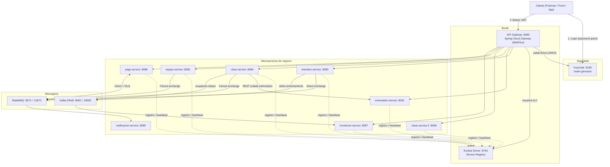
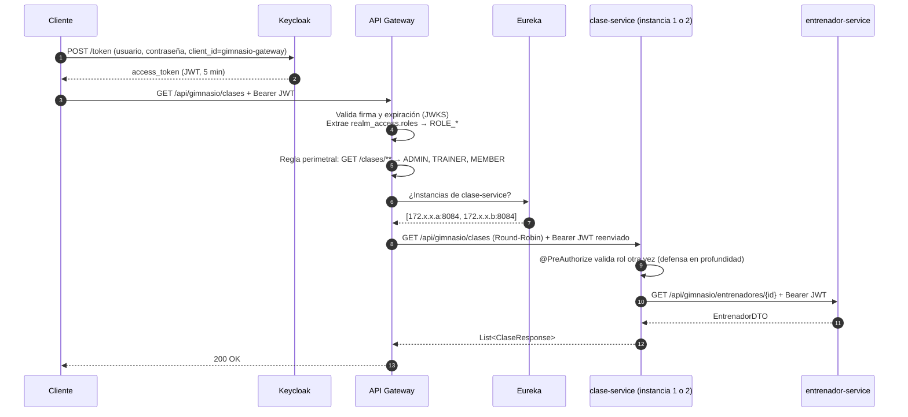
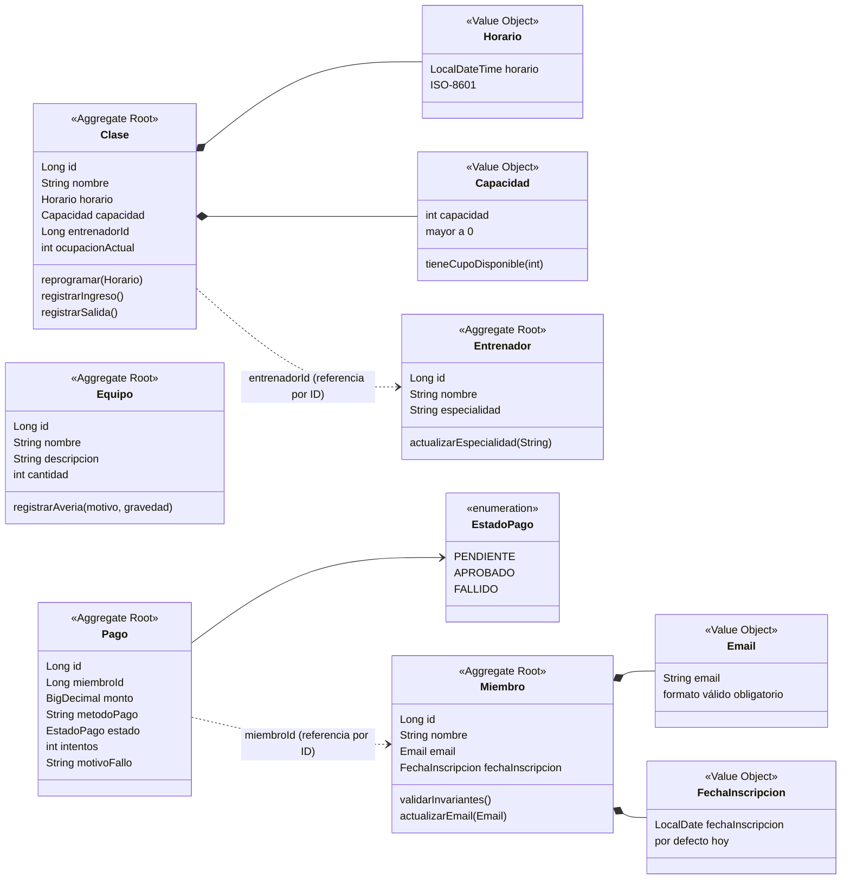

# 01 · Arquitectura del Sistema

> Sistema distribuido de gestión de gimnasio construido con **Spring Boot 3.3.2**, **Spring Cloud 2023.0.3** y **Java 17**, resultado de refactorizar un monolito en microservicios aplicando **Domain-Driven Design (DDD)**.

---

## 1. Visión general

El sistema se divide en **8 microservicios de negocio/infraestructura** más **4 componentes de soporte** (Eureka, Keycloak, RabbitMQ y Kafka). Todo el tráfico externo entra por un único punto: el **API Gateway** (Spring Cloud Gateway), que autentica con Keycloak, enruta con balanceo de carga usando Eureka y expone un endpoint de agregación.



---

## 2. Catálogo de servicios

| Servicio | Módulo | Puerto | Nombre en Eureka | Responsabilidad (Bounded Context) | Persistencia |
|---|---|---|---|---|---|
| **API Gateway** | `services/api-gateway` | 8080 | `api-gateway` | Punto de entrada único, enrutamiento, seguridad perimetral, balanceo y agregación | — |
| **Eureka Server** | `services/eureka-server` | 8761 | — (es el registro) | Registro y descubrimiento de servicios | En memoria |
| **Entrenadores** | `services/entrenador-microservice` | 8081 | `entrenador-service` | Gestión de instructores y especialidades | H2 en memoria |
| **Equipos** | `services/equipo-microservice` | 8082 | `equipo-service` | Inventario de máquinas y reporte de averías | H2 en memoria |
| **Miembros** | `services/miembro-microservice` | 8083 | `miembro-service` | Socios, inscripción y registro de entrenamientos | H2 en memoria |
| **Clases** | `services/clase-microservice` | 8084 (+8088 réplica) | `clase-service` | Programación de clases, horarios y aforo | H2 en memoria |
| **Notificaciones** | `services/notificacion-microservice` | 8085 | *(no se registra)* | Consumidor de eventos RabbitMQ (emails, push, auditoría) | — |
| **Pagos** | `services/pago-microservice` | 8086 | `pago-service` | Pagos asíncronos con reintentos y Dead Letter Queue | H2 en memoria |
| **Monitoreo** | `services/monitoreo-microservice` | 8087 | `monitoreo-service` | Dashboard de ocupación (Kafka), Kafka Streams y checkpoints | H2 en archivo (volumen `monitoreo-data`) |

### Infraestructura

| Componente | Imagen | Puertos | Uso |
|---|---|---|---|
| **Keycloak** | `quay.io/keycloak/keycloak:24.0` | `8180 → 8080` | Proveedor de identidad OAuth2/OIDC. Importa `keycloak/realm/gimnasio-realm.json` al iniciar |
| **RabbitMQ** | `rabbitmq:3-management` | `5672` (AMQP), `15672` (UI) | Mensajería asíncrona (Direct, Fanout, DLX/DLQ) |
| **Kafka** | `apache/kafka:3.8.0` (modo KRaft, sin Zookeeper) | `9092` (red interna), `29092` (host) | Streaming de eventos y Kafka Streams |

---

## 3. Patrones de comunicación

El sistema combina **cuatro estilos** de comunicación, cada uno elegido según la necesidad del caso de uso.

| Estilo | Tecnología | Dónde se usa | Por qué |
|---|---|---|---|
| **Síncrono externo** | HTTP + Spring Cloud Gateway + `lb://` | Cliente → Gateway → microservicios | Único punto de entrada, seguridad centralizada, balanceo |
| **Síncrono interno** | `RestTemplate` con propagación del JWT | `clase-service` → `entrenador-service` | Validar que el entrenador exista y enriquecer la respuesta |
| **Composición reactiva** | `WebClient` `@LoadBalanced` + `Mono.zip` | Gateway → miembro + clase + pago | Agregar datos de varios servicios en una sola respuesta |
| **Asíncrono (colas)** | RabbitMQ | Inscripción, cambio de horario, averías, pagos | Desacoplar, responder rápido al usuario y reintentar |
| **Streaming** | Kafka + Kafka Streams | Ocupación en tiempo real, análisis semanal | Alto volumen, reprocesamiento y ventanas de tiempo |

### 3.1 Flujo de una petición típica



### 3.2 Mensajería asíncrona (RabbitMQ)

| Caso de uso | Productor | Exchange (tipo) | Routing key | Cola(s) | Consumidor |
|---|---|---|---|---|---|
| Bienvenida a nuevo socio | `miembro-service` | `gimnasio.miembro.exchange` (Direct) | `miembro.inscrito` | `miembro.inscripcion.notificacion` | `notificacion-service` |
| Cambio de horario de clase | `clase-service` | `gimnasio.clase.horario.events` (Fanout) | — | `clase.horario.app-movil`, `clase.horario.email`, `clase.horario.auditoria` | `notificacion-service` |
| Avería de equipo | `equipo-service` | `gimnasio.equipo.events` (Fanout) | — | `equipo.averia.mantenimiento`, `equipo.averia.entrenadores`, `equipo.averia.app-socios` | `notificacion-service` |
| Procesamiento de pago | `pago-service` | `gimnasio.pagos.exchange` (Direct) | `pago.procesar` | `pagos.procesamiento` | `pago-service` |
| Pago fallido | RabbitMQ (DLX) | `gimnasio.pagos.dlx` (Direct) | `pago.fallido` | `pagos.procesamiento.dlq` | `pago-service` (marca `FALLIDO`) |

> Detalle teórico y práctico completo en [`05-MENSAJERIA.md`](05-MENSAJERIA.md) y [`RABBITMQ_Y_DLQ_GUIA.md`](RABBITMQ_Y_DLQ_GUIA.md).

### 3.3 Streaming (Kafka)

| Topic | Productor | Key | Particiones | Retención | Consumidores |
|---|---|---|---|---|---|
| `ocupacion-clases` | `clase-service` | `claseId` | 3 | 7 días | `monitoreo-grupo` (dashboard + SSE), `recuperacion-grupo` (checkpoints) |
| `datos-entrenamiento` | `miembro-service` | `miembroId` | 3 | 30 días | Kafka Streams (ventana 7 días), `recuperacion-grupo` |
| `resumen-entrenamiento` | Kafka Streams (`monitoreo-service`) | `miembroId` | 3 | Compactado | Consulta / auditoría |

---

## 4. Modelo de dominio (DDD)

Cada microservicio es un **Bounded Context** con su propia base de datos (patrón *Database per Service*). Las relaciones entre contextos se hacen **por identificador** (ej. `Clase.entrenadorId`, `Pago.miembroId`), nunca con claves foráneas entre bases de datos.



### 4.1 Invariantes de dominio

| Agregado / VO | Regla | Error que produce |
|---|---|---|
| `Miembro` | Nombre y email obligatorios; fecha por defecto = hoy | `400 Bad Request` |
| `Email` (VO) | Debe cumplir `^[^@\s]+@[^@\s]+\.[^@\s]+$` | `400 Bad Request` |
| `FechaInscripcion` (VO) | Formato `YYYY-MM-DD`, no nula | `400 Bad Request` |
| `Clase` | Nombre, horario, capacidad y `entrenadorId > 0` obligatorios | `400 Bad Request` |
| `Clase.registrarIngreso()` | No puede superar la capacidad | `409 Conflict` |
| `Clase.registrarSalida()` | No puede bajar de 0 asistentes | `409 Conflict` |
| `Capacidad` (VO) | Entero mayor a 0 | `400 Bad Request` |
| `Horario` (VO) | ISO-8601 (`2026-09-01T10:00:00`) | `400 Bad Request` |
| `Entrenador` | Nombre y especialidad obligatorios | `400 Bad Request` |
| `Equipo` | Nombre y descripción obligatorios, `cantidad > 0` | `400 Bad Request` |
| `Equipo.registrarAveria()` | Motivo obligatorio; gravedad por defecto `MEDIA`; reemplaza la avería anterior en la descripción | `400 Bad Request` |
| Validación entre contextos | `POST /clases` verifica contra `entrenador-service` que el entrenador exista | `404 Not Found` / `503` si no responde |

### 4.2 Datos semilla (`DataLoader`)

Al iniciar, cada servicio carga datos de ejemplo en su base H2:

| Servicio | Datos |
|---|---|
| `entrenador-service` | 2 entrenadores (IDs 1 y 2) |
| `clase-service` | 2 clases para mañana a las 08:00 (capacidad 20) y 18:00 (capacidad 15) |
| `equipo-service` | 2 equipos |
| `miembro-service` | 2 miembros: `juan@email.com` (hoy) y `maria@email.com` (hace 30 días) |

> [!NOTE]
> Como `clase-service` y `clase-service-2` tienen **cada una su propia H2 en memoria**, los datos creados en una réplica no aparecen en la otra. Es esperado en esta demo de balanceo; en producción ambas réplicas compartirían una base de datos externa.

---

## 5. Estructura del repositorio

```text
microservicios-gimnasio-monorepo/
├── pom.xml                         # POM agregador (9 módulos)
├── docker-compose.yml              # Orquesta infraestructura + servicios
├── keycloak/realm/
│   └── gimnasio-realm.json         # Realm, roles, clientes y usuarios de prueba
├── postman/
│   ├── gimnasio.postman_collection.json
│   ├── gimnasio.postman_environment.json
│   ├── Gimnasio Local (Docker).environment.yaml
│   └── GUIA_PRUEBAS_POSTMAN.md
├── doc/                            # Esta documentación
└── services/
    ├── api-gateway/                # Spring Cloud Gateway (reactivo)
    ├── eureka-server/              # Netflix Eureka Server
    ├── miembro-microservice/
    ├── entrenador-microservice/
    ├── clase-microservice/
    ├── equipo-microservice/
    ├── pago-microservice/
    ├── monitoreo-microservice/
    └── notificacion-microservice/
```

Cada microservicio sigue la misma estructura interna por capas:

```text
src/main/java/co/analisys/gimnasio/
├── GimnasioApplication.java   # Punto de entrada
├── DataLoader.java            # Datos semilla
├── config/                    # Security, RabbitMQ, Kafka, OpenAPI
├── controller/                # API REST
├── dto/                       # Requests, responses y eventos
├── exception/                 # GlobalExceptionHandler (@RestControllerAdvice)
├── model/                     # Entidades y Value Objects
├── repository/                # Spring Data JPA
├── service/                   # Lógica de aplicación y productores
└── listener/                  # Consumidores de RabbitMQ / Kafka
```

---

## 6. Stack tecnológico

| Capa | Tecnología | Versión |
|---|---|---|
| Lenguaje | Java | 17 |
| Framework | Spring Boot | 3.3.2 |
| Nube | Spring Cloud (Gateway, Netflix Eureka, LoadBalancer) | 2023.0.3 |
| Seguridad | Spring Security OAuth2 Resource Server + Keycloak | Keycloak 24.0 |
| Persistencia | Spring Data JPA + H2 | — |
| Mensajería | Spring AMQP + RabbitMQ | RabbitMQ 3 |
| Streaming | Spring Kafka + Kafka Streams | Kafka 3.8.0 (KRaft) |
| Documentación API | springdoc-openapi | 2.6.0 |
| Utilidades | Lombok | — |
| Contenedores | Docker + Docker Compose | — |
| Pruebas de API | Postman / Newman | — |
