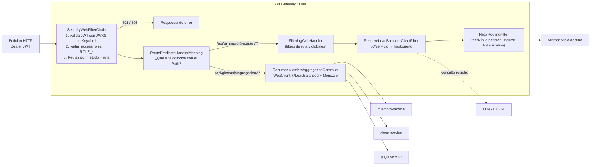
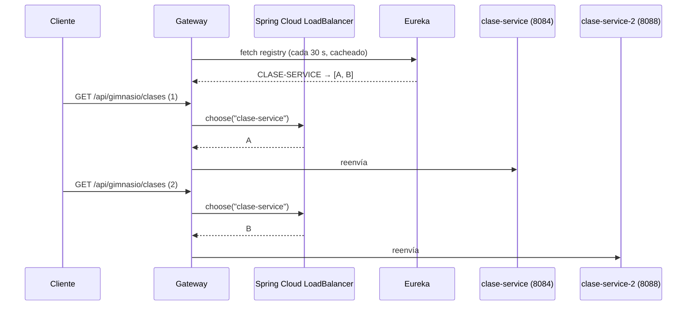
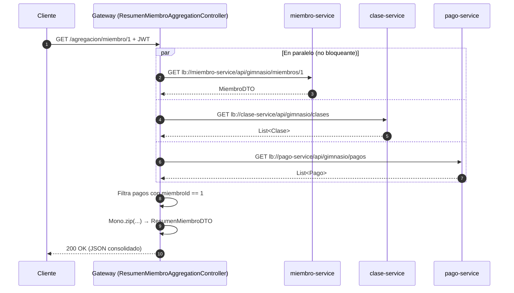

# 02 · API Gateway con Spring Cloud Gateway

> **Objetivo del taller:** crear un API Gateway con Spring Boot y Spring Cloud Gateway para los microservicios del gimnasio.
> **Módulo:** [`services/api-gateway`](../services/api-gateway) · **Puerto:** `8080` · **Stack:** reactivo (WebFlux + Netty)

---

## 1. Cumplimiento de los requisitos del taller

| # | Requisito del enunciado | Implementación | Archivo |
|---|---|---|---|
| 1 | Crear el proyecto con Spring Cloud Gateway, Actuator y Security | Dependencias `spring-cloud-starter-gateway`, `spring-boot-starter-actuator`, `spring-boot-starter-security`, `oauth2-resource-server` | [`pom.xml`](../services/api-gateway/pom.xml) |
| 2.1 | Configurar rutas en `application.yml` | 5 rutas declarativas (miembros, clases, entrenadores, pagos, monitoreo) | [`application.yml`](../services/api-gateway/src/main/resources/application.yml) |
| 2.2 | Clase de configuración para enrutamiento | `RouteLocator` programático para equipos | [`GatewayRoutesConfig.java`](../services/api-gateway/src/main/java/co/analisys/gimnasio/config/GatewayRoutesConfig.java) |
| 3.1 | Configurar Keycloak para el realm del gimnasio | Realm `gimnasio` importado automáticamente, 3 roles, 3 usuarios, cliente público `gimnasio-gateway` | [`gimnasio-realm.json`](../keycloak/realm/gimnasio-realm.json) |
| 3.2 | Autenticación y autorización en el Gateway | `SecurityWebFilterChain` reactivo + conversor de roles de Keycloak + reglas por método y ruta | [`SecurityConfig.java`](../services/api-gateway/src/main/java/co/analisys/gimnasio/config/SecurityConfig.java) |
| 3.3 | Forwarding del JWT a los microservicios | Spring Cloud Gateway reenvía el header `Authorization` en todas las rutas; la agregación lo propaga explícitamente en cada `WebClient` | [`ResumenMiembroAggregationController.java`](../services/api-gateway/src/main/java/co/analisys/gimnasio/controller/ResumenMiembroAggregationController.java) |
| 4.1 | Añadir Spring Cloud LoadBalancer | `spring-cloud-starter-loadbalancer` (Round-Robin por defecto) | [`pom.xml`](../services/api-gateway/pom.xml) |
| 4.2 | Configurar Eureka | Nuevo módulo `eureka-server`; todos los servicios se registran como clientes | [`eureka-server`](../services/eureka-server) |
| 4.3 | Rutas con nombres de servicio | Todas las rutas usan `lb://<nombre-servicio>`; se levantan 2 réplicas de `clase-service` | [`docker-compose.yml`](../docker-compose.yml) |
| 5.1 | Filtro de agregación de respuestas | Composición reactiva `Mono.zip` de miembro + clases + pagos (filtrados por miembro) | [`ResumenMiembroAggregationController.java`](../services/api-gateway/src/main/java/co/analisys/gimnasio/controller/ResumenMiembroAggregationController.java) |
| 5.2 | Ruta específica para la agregación | `GET /api/gimnasio/agregacion/miembro/{id}` | ídem |

---

## 2. Evolución: de proxy manual a Spring Cloud Gateway

| Antes (versión MVC) | Ahora (Spring Cloud Gateway) |
|---|---|
| `spring-boot-starter-web` (Servlet, bloqueante) | `spring-cloud-starter-gateway` (WebFlux + Netty, no bloqueante) |
| 6 controladores proxy escritos a mano (`MiembroGatewayController`, `ClaseGatewayController`, …) | 0 controladores proxy: las rutas se **declaran** |
| `RestClient` con URLs fijas (`http://clase-service:8084`) | `lb://clase-service` resuelto en Eureka |
| Una sola instancia por servicio | Varias instancias con balanceo Round-Robin |
| Cada endpoint nuevo exigía código en el Gateway | Basta con que el path coincida con el predicado `Path=/api/gimnasio/<recurso>/**` |
| `@EnableWebSecurity` (Servlet) | `@EnableWebFluxSecurity` + `SecurityWebFilterChain` |

---

## 3. Arquitectura interna del Gateway



### 3.1 Componentes del módulo

| Clase / archivo | Tipo | Responsabilidad |
|---|---|---|
| `GimnasioApplication` | `@SpringBootApplication` + `@EnableDiscoveryClient` | Arranca el Gateway y lo registra en Eureka |
| `application.yml` | Configuración | Rutas declarativas, JWT de Keycloak, cliente Eureka y Actuator |
| `GatewayRoutesConfig` | `@Configuration` | Ruta programática `ruta-equipos-programatica` con `RouteLocatorBuilder` |
| `SecurityConfig` | `@EnableWebFluxSecurity` | Cadena de seguridad reactiva y conversor de roles |
| `WebClientConfig` | `@Configuration` | `WebClient.Builder` anotado con `@LoadBalanced` |
| `ResumenMiembroAggregationController` | `@RestController` reactivo | Endpoint de agregación (API Composition) |
| `ApiGateway` | `@RestController` | `GET /api/gimnasio` → `"API is working"` (health check público) |
| `MiembroDTO`, `ResumenMiembroDTO` | DTOs | Modelo de la respuesta agregada |

---

## 4. Paso 1 · Proyecto y dependencias

```xml
<!-- Spring Cloud Gateway (Reactivo, WebFlux + Netty) -->
<dependency>
    <groupId>org.springframework.cloud</groupId>
    <artifactId>spring-cloud-starter-gateway</artifactId>
</dependency>

<!-- Registro y Balanceo de Carga Reactivo -->
<dependency>
    <groupId>org.springframework.cloud</groupId>
    <artifactId>spring-cloud-starter-netflix-eureka-client</artifactId>
</dependency>
<dependency>
    <groupId>org.springframework.cloud</groupId>
    <artifactId>spring-cloud-starter-loadbalancer</artifactId>
</dependency>

<!-- Seguridad Reactiva OAuth2 / Keycloak Resource Server -->
<dependency>
    <groupId>org.springframework.boot</groupId>
    <artifactId>spring-boot-starter-security</artifactId>
</dependency>
<dependency>
    <groupId>org.springframework.boot</groupId>
    <artifactId>spring-boot-starter-oauth2-resource-server</artifactId>
</dependency>

<!-- Monitoreo y Métricas -->
<dependency>
    <groupId>org.springframework.boot</groupId>
    <artifactId>spring-boot-starter-actuator</artifactId>
</dependency>
```

> [!IMPORTANT]
> Spring Cloud Gateway **no es compatible** con `spring-boot-starter-web` (Spring MVC). Por eso el Gateway no incluye esa dependencia ni `springdoc-openapi-starter-webmvc-ui`; toda la configuración de seguridad usa las variantes **reactivas** (`ServerHttpSecurity`, `SecurityWebFilterChain`, `ReactiveJwtAuthenticationConverterAdapter`).

Actuator expone los endpoints `health`, `info` y `gateway`:

```yaml
management:
  endpoints:
    web:
      exposure:
        include: health,info,gateway
  endpoint:
    gateway:
      enabled: true
```

---

## 5. Paso 2 · Enrutamiento

Una **ruta** en Spring Cloud Gateway se compone de:

- **ID**: nombre único de la ruta.
- **URI de destino**: a dónde se reenvía (`lb://` = resolver en Eureka y balancear).
- **Predicados**: condiciones que debe cumplir la petición (aquí, el `Path`).
- **Filtros** (opcionales): transformaciones sobre la petición/respuesta.

### 5.1 Rutas declarativas (`application.yml`)

```yaml
spring:
  cloud:
    gateway:
      discovery:
        locator:
          enabled: false        # Solo se exponen las rutas definidas explícitamente
      routes:
        - id: ruta-miembros
          uri: lb://miembro-service
          predicates:
            - Path=/api/gimnasio/miembros/**
        - id: ruta-clases
          uri: lb://clase-service
          predicates:
            - Path=/api/gimnasio/clases/**
        - id: ruta-entrenadores
          uri: lb://entrenador-service
          predicates:
            - Path=/api/gimnasio/entrenadores/**
        - id: ruta-pagos
          uri: lb://pago-service
          predicates:
            - Path=/api/gimnasio/pagos/**
        - id: ruta-monitoreo
          uri: lb://monitoreo-service
          predicates:
            - Path=/api/gimnasio/monitoreo/**
```

> `discovery.locator.enabled: false` evita que el Gateway cree rutas automáticas por cada servicio de Eureka (`/miembro-service/**`, etc.). Así **solo** se exponen las rutas que diseñamos.

### 5.2 Ruta programática (`GatewayRoutesConfig.java`)

```java
@Configuration
public class GatewayRoutesConfig {

    @Bean
    public RouteLocator customRouteLocator(RouteLocatorBuilder builder) {
        return builder.routes()
            .route("ruta-equipos-programatica", r -> r
                .path("/api/gimnasio/equipos/**")
                .uri("lb://equipo-service"))
            .build();
    }
}
```

Ambos mecanismos conviven: Spring Cloud Gateway **combina** las rutas del YAML y las de todos los beans `RouteLocator`.

### 5.3 Tabla de enrutamiento resultante

| ID de ruta | Origen | Predicado | Destino | Instancias |
|---|---|---|---|---|
| `ruta-miembros` | YAML | `Path=/api/gimnasio/miembros/**` | `lb://miembro-service` | 1 |
| `ruta-clases` | YAML | `Path=/api/gimnasio/clases/**` | `lb://clase-service` | **2** (8084 y 8088) |
| `ruta-entrenadores` | YAML | `Path=/api/gimnasio/entrenadores/**` | `lb://entrenador-service` | 1 |
| `ruta-pagos` | YAML | `Path=/api/gimnasio/pagos/**` | `lb://pago-service` | 1 |
| `ruta-monitoreo` | YAML | `Path=/api/gimnasio/monitoreo/**` | `lb://monitoreo-service` | 1 |
| `ruta-equipos-programatica` | Java | `Path=/api/gimnasio/equipos/**` | `lb://equipo-service` | 1 |
| *(controlador local)* | Java | `GET /api/gimnasio/agregacion/miembro/{id}` | Gateway (composición) | — |
| *(controlador local)* | Java | `GET /api/gimnasio` | Gateway (health) | — |

> `notificacion-service` **no** tiene ruta: es un consumidor interno de RabbitMQ y no expone API pública.

Para verlas en vivo:

```bash
curl http://localhost:8080/actuator/gateway/routes | python3 -m json.tool
```

---

## 6. Paso 3 · Seguridad con Keycloak

### 6.1 Configuración del Resource Server

```yaml
spring:
  security:
    oauth2:
      resourceserver:
        jwt:
          issuer-uri: ${KEYCLOAK_ISSUER_URI:http://localhost:8180/realms/gimnasio}
          jwk-set-uri: ${KEYCLOAK_JWK_SET_URI:http://localhost:8180/realms/gimnasio/protocol/openid-connect/certs}
```

> [!NOTE]
> En Docker se usan **dos URLs distintas** a propósito:
> - `issuer-uri = http://localhost:8180/...` → debe coincidir con el claim `iss` del token, que Keycloak firma con la URL que usó el cliente (Postman en el host).
> - `jwk-set-uri = http://keycloak:8080/...` → el contenedor del Gateway descarga las llaves públicas por la red interna de Docker.

### 6.2 Cadena de filtros reactiva

```java
@Configuration
@EnableWebFluxSecurity
public class SecurityConfig {

    @Bean
    public SecurityWebFilterChain springSecurityFilterChain(ServerHttpSecurity http) {
        return http
            .csrf(ServerHttpSecurity.CsrfSpec::disable)
            .authorizeExchange(exchanges -> exchanges
                .pathMatchers("/actuator/**", "/api/gimnasio").permitAll()
                .pathMatchers(HttpMethod.POST, "/api/gimnasio/entrenadores/**").hasRole("ADMIN")
                .pathMatchers(HttpMethod.GET,  "/api/gimnasio/pagos").hasRole("ADMIN")
                .pathMatchers(HttpMethod.POST, "/api/gimnasio/equipos/**").hasAnyRole("ADMIN", "TRAINER")
                .pathMatchers(HttpMethod.PUT,  "/api/gimnasio/clases/**").hasAnyRole("ADMIN", "TRAINER")
                .pathMatchers(HttpMethod.GET,  "/api/gimnasio/monitoreo/**").hasAnyRole("ADMIN", "TRAINER")
                .pathMatchers(HttpMethod.POST, "/api/gimnasio/miembros").hasAnyRole("ADMIN", "MEMBER")
                .pathMatchers(HttpMethod.GET,  "/api/gimnasio/miembros").hasAnyRole("ADMIN", "TRAINER")
                .pathMatchers(HttpMethod.GET,  "/api/gimnasio/miembros/*").hasAnyRole("ADMIN", "TRAINER", "MEMBER")
                .pathMatchers(HttpMethod.POST, "/api/gimnasio/clases").hasAnyRole("ADMIN", "TRAINER")
                .pathMatchers(HttpMethod.GET,  "/api/gimnasio/clases/**").hasAnyRole("ADMIN", "TRAINER", "MEMBER")
                .pathMatchers("/api/gimnasio/agregacion/**").hasAnyRole("ADMIN", "TRAINER", "MEMBER")
                .anyExchange().authenticated()
            )
            .oauth2ResourceServer(oauth2 -> oauth2
                .jwt(jwt -> jwt.jwtAuthenticationConverter(reactiveJwtAuthenticationConverter()))
            )
            .build();
    }
}
```

- Las reglas se evalúan **en orden**; la primera que coincide gana.
- `anyExchange().authenticated()` garantiza que **ninguna ruta** quede abierta por olvido.
- `csrf` se desactiva porque es una API stateless con tokens Bearer (no hay cookies de sesión).

### 6.3 Conversión de roles de Keycloak

Keycloak coloca los roles del realm dentro del claim anidado `realm_access.roles`, que Spring Security no lee por defecto. El conversor los transforma en `GrantedAuthority`:

```java
@Bean
public Converter<Jwt, Mono<AbstractAuthenticationToken>> reactiveJwtAuthenticationConverter() {
    JwtAuthenticationConverter delegate = new JwtAuthenticationConverter();
    delegate.setJwtGrantedAuthoritiesConverter(jwt -> {
        Map<String, Object> realmAccess = jwt.getClaimAsMap("realm_access");
        if (realmAccess == null || !(realmAccess.get("roles") instanceof Collection<?> rawRoles)) {
            return Collections.emptyList();
        }
        return rawRoles.stream()
            .filter(String.class::isInstance)
            .map(String.class::cast)
            .map(role -> role.startsWith("ROLE_") ? role : "ROLE_" + role)
            .map(SimpleGrantedAuthority::new)
            .collect(Collectors.toList());
    });
    return new ReactiveJwtAuthenticationConverterAdapter(delegate);
}
```

Ejemplo de payload de token:

```json
{
  "iss": "http://localhost:8180/realms/gimnasio",
  "preferred_username": "admin",
  "realm_access": { "roles": ["ROLE_ADMIN", "default-roles-gimnasio"] },
  "exp": 1791836805
}
```

→ Authorities resultantes: `ROLE_ADMIN`, `ROLE_default-roles-gimnasio` → `hasRole("ADMIN")` = ✅.

### 6.4 Forwarding del token JWT

| Camino | Cómo se reenvía el token |
|---|---|
| Rutas del Gateway (`lb://…`) | Spring Cloud Gateway copia **todos los headers** de la petición original al microservicio, incluido `Authorization: Bearer …`. No se configura el filtro `RemoveRequestHeader`, por lo que el token llega intacto |
| Endpoint de agregación | Se lee con `@RequestHeader(HttpHeaders.AUTHORIZATION)` y se añade explícitamente a cada llamada del `WebClient` |
| `clase-service` → `entrenador-service` | `ClaseService.crearHttpEntityConAuth()` copia el header de la petición entrante al `RestTemplate` |

Gracias a esto cada microservicio **vuelve a validar** el token y sus `@PreAuthorize` (defensa en profundidad). Ver matriz completa en [`03-SEGURIDAD.md`](03-SEGURIDAD.md).

---

## 7. Paso 4 · Balanceo de carga con Eureka

### 7.1 Eureka Server

```java
@SpringBootApplication
@EnableEurekaServer
public class EurekaServerApplication { ... }
```

```yaml
server:
  port: 8761
eureka:
  instance:
    hostname: eureka-server
  client:
    register-with-eureka: false      # El servidor no se registra a sí mismo
    fetch-registry: false
  server:
    wait-time-in-ms-when-sync-empty: 0
    enable-self-preservation: false   # Elimina rápido instancias caídas (útil en demo)
```

### 7.2 Clientes Eureka (todos los microservicios)

Cada microservicio añade `spring-cloud-starter-netflix-eureka-client` y:

```properties
spring.application.name=clase-service
eureka.client.service-url.defaultZone=${EUREKA_CLIENT_SERVICEURL_DEFAULTZONE:http://eureka-server:8761/eureka/}
eureka.instance.prefer-ip-address=true
eureka.instance.instance-id=${spring.application.name}:${server.port}:${random.value}
```

- `spring.application.name` es el **nombre lógico** que usa `lb://`.
- `prefer-ip-address=true` registra la IP del contenedor (resoluble entre contenedores).
- `instance-id` con `${random.value}` evita que dos réplicas en el mismo puerto interno (`8084`) se sobrescriban en el registro.

### 7.3 Réplica para la demostración

```yaml
clase-service:
  build: ./services/clase-microservice
  ports: ["8084:8084"]

clase-service-2:            # Segunda instancia → mismo spring.application.name
  build: ./services/clase-microservice
  ports: ["8088:8084"]
```



**Cómo demostrarlo:**

1. Abrir `http://localhost:8761` → en *Instances currently registered* aparece `CLASE-SERVICE` con **2** instancias.
2. Ejecutar varias veces `GET /api/gimnasio/clases` y observar los logs:
   ```bash
   docker compose logs -f clase-service clase-service-2
   ```
   Las peticiones se alternan entre ambos contenedores (Round-Robin).
3. Detener una réplica (`docker compose stop clase-service-2`): tras el siguiente refresco del registro, todo el tráfico va a la instancia restante sin cambiar la configuración del Gateway.

---

## 8. Paso 5 · Agregación de respuestas (API Composition)

### 8.1 Endpoint

```
GET /api/gimnasio/agregacion/miembro/{id}
Authorization: Bearer <token>
```

Roles permitidos: `ADMIN`, `TRAINER`, `MEMBER`.

### 8.2 Funcionamiento



### 8.3 Código clave

```java
@Bean
@LoadBalanced                       // Permite usar lb://nombre-servicio en el WebClient
public WebClient.Builder loadBalancedWebClientBuilder() {
    return WebClient.builder();
}
```

```java
Mono<List<Map<String, Object>>> pagosMono = client.get()
        .uri("lb://pago-service/api/gimnasio/pagos")
        .headers(h -> { if (authHeader != null) h.set(HttpHeaders.AUTHORIZATION, authHeader); })
        .retrieve()
        .bodyToMono(new ParameterizedTypeReference<List<Map<String, Object>>>() {})
        .map(pagos -> pagos.stream()
                .filter(p -> p.get("miembroId") != null
                        && String.valueOf(id).equals(String.valueOf(p.get("miembroId"))))
                .toList())
        .onErrorResume(e -> Mono.just(Collections.emptyList()));   // Degradación elegante

return Mono.zip(miembroMono, clasesMono, pagosMono)
        .map(t -> new ResumenMiembroDTO(t.getT1(), t.getT2(), t.getT3(),
                "Resumen consolidado generado por Spring Cloud Gateway"));
```

### 8.4 Respuesta de ejemplo

```json
{
  "miembro": {
    "id": 1,
    "nombre": "Juan Pérez",
    "email": "juan@email.com",
    "fechaInscripcion": "2026-10-12"
  },
  "clasesDisponibles": [
    {
      "id": 1, "nombre": "Yoga", "horario": "2026-10-13T08:00:00",
      "capacidadMaxima": 20, "ocupacionActual": 0,
      "entrenador": { "id": 1, "nombre": "...", "especialidad": "..." }
    }
  ],
  "pagosRegistrados": [
    { "id": 1, "miembroId": 1, "monto": 150000, "metodoPago": "TARJETA", "estado": "APROBADO", "intentos": 1 }
  ],
  "mensaje": "Resumen consolidado generado por Spring Cloud Gateway"
}
```

### 8.5 Decisiones de diseño

| Decisión | Justificación |
|---|---|
| Controlador reactivo en lugar de un `GatewayFilter` que reescriba el body | Modificar respuestas dentro de un filtro obliga a bufferizar el cuerpo completo (`ModifyResponseBodyGatewayFilterFactory`) y complica el manejo de errores. Un endpoint de composición con `WebClient` es el patrón **API Composition / Gateway Aggregation** recomendado y sigue siendo 100 % no bloqueante |
| `Mono.zip` | Las 3 llamadas se ejecutan **concurrentemente**: el tiempo total ≈ la llamada más lenta, no la suma |
| `onErrorResume` en cada llamada | Si un servicio falla, la respuesta se entrega igual con valores por defecto (`"Desconocido"` / `[]`) en lugar de un `500` |
| `@LoadBalanced` | La agregación también se beneficia de Eureka y del balanceo (p. ej. alterna entre las 2 réplicas de clases) |
| Filtrado de pagos por `miembroId` en el Gateway | `pago-service` no expone un endpoint de pagos por miembro; el Gateway filtra para devolver solo los del socio consultado |

> [!WARNING]
> `GET /api/gimnasio/pagos` en `pago-service` solo está permitido a `ADMIN`. Si se consulta la agregación con un token de `TRAINER` o `MEMBER`, `pago-service` responde `403` y `pagosRegistrados` llega vacío (`[]`) gracias a `onErrorResume`. **Para la demo usar el token de `ADMIN`.**

---

## 9. Configuración completa (`application.yml`)

```yaml
server:
  port: 8080

spring:
  application:
    name: api-gateway
  cloud:
    gateway:
      discovery:
        locator:
          enabled: false
      routes: [ ...ver sección 5.1... ]
  security:
    oauth2:
      resourceserver:
        jwt:
          issuer-uri: ${KEYCLOAK_ISSUER_URI:http://localhost:8180/realms/gimnasio}
          jwk-set-uri: ${KEYCLOAK_JWK_SET_URI:http://localhost:8180/realms/gimnasio/protocol/openid-connect/certs}

eureka:
  client:
    service-url:
      defaultZone: ${EUREKA_CLIENT_SERVICEURL_DEFAULTZONE:http://eureka-server:8761/eureka/}
  instance:
    prefer-ip-address: true

management:
  endpoints:
    web:
      exposure:
        include: health,info,gateway
  endpoint:
    gateway:
      enabled: true
```

| Variable de entorno | Valor en Docker | Propósito |
|---|---|---|
| `KEYCLOAK_ISSUER_URI` | `http://localhost:8180/realms/gimnasio` | Validar claim `iss` |
| `KEYCLOAK_JWK_SET_URI` | `http://keycloak:8080/realms/gimnasio/protocol/openid-connect/certs` | Descargar llaves públicas |
| `EUREKA_CLIENT_SERVICEURL_DEFAULTZONE` | `http://eureka-server:8761/eureka/` | Ubicación del registro |

---

## 10. Endpoints de observación

| URL | Auth | Qué muestra |
|---|---|---|
| `GET http://localhost:8080/api/gimnasio` | Pública | `API is working` |
| `GET http://localhost:8080/actuator/health` | Pública | Estado del Gateway (`UP`) |
| `GET http://localhost:8080/actuator/gateway/routes` | Pública | Todas las rutas cargadas con predicados y URIs |
| `GET http://localhost:8080/actuator/gateway/routes/{id}` | Pública | Detalle de una ruta (ej. `ruta-clases`) |
| `http://localhost:8761` | Pública | Dashboard de Eureka con instancias registradas |

> [!CAUTION]
> `/actuator/**` está abierto para facilitar la demo. En producción debería restringirse (p. ej. `hasRole("ADMIN")` o exponerse solo en una red de administración).

---

## 11. Guion sugerido para la sustentación (≈ 10 min)

| Min | Paso | Qué mostrar |
|---|---|---|
| 0–1 | Contexto | Diagrama de la sección 3: el Gateway como único punto de entrada |
| 1–2 | Paso 1 | `pom.xml`: Gateway reactivo, Actuator, Security, Eureka, LoadBalancer |
| 2–4 | Paso 2 | `application.yml` (5 rutas) + `GatewayRoutesConfig` (ruta Java) → `GET /actuator/gateway/routes` en Postman |
| 4–6 | Paso 3 | Keycloak (realm, roles, usuarios) → `SecurityConfig` → demo: sin token `401`, `MEMBER` en `GET /miembros` `403`, `ADMIN` `200` |
| 6–8 | Paso 4 | Dashboard Eureka con 2 instancias de `CLASE-SERVICE` → varios `GET /clases` con `docker compose logs -f clase-service clase-service-2` |
| 8–10 | Paso 5 | `ResumenMiembroAggregationController` → `GET /agregacion/miembro/1` con token de ADMIN → explicar `Mono.zip` y `onErrorResume` (detener `pago-service` y mostrar que la respuesta sigue llegando) |

### Preguntas frecuentes del profesor

<details>
<summary><b>¿Por qué Spring Cloud Gateway y no un controlador con RestTemplate?</b></summary>

Porque es un proxy declarativo, reactivo y no bloqueante (Netty): maneja miles de conexiones concurrentes con pocos hilos, y añadir un servicio solo requiere una ruta, no código. Además se integra nativamente con Eureka (`lb://`), Security y Actuator.
</details>

<details>
<summary><b>¿Qué significa <code>lb://</code>?</b></summary>

Es el esquema que activa el `ReactiveLoadBalancerClientFilter`: en lugar de un host fijo, toma el nombre lógico (`clase-service`), consulta las instancias registradas en Eureka y elige una con Spring Cloud LoadBalancer (Round-Robin por defecto).
</details>

<details>
<summary><b>¿Dónde está el forwarding del JWT?</b></summary>

Spring Cloud Gateway propaga por defecto todos los headers de la petición original, incluido `Authorization`. En la agregación se reenvía explícitamente con `.headers(h -> h.set(AUTHORIZATION, authHeader))`. Cada microservicio vuelve a validar el token (defensa en profundidad).
</details>

<details>
<summary><b>¿Por qué se valida el rol dos veces (Gateway y microservicio)?</b></summary>

El Gateway rechaza temprano peticiones no autorizadas (ahorra recursos) y el microservicio protege su API aunque alguien acceda directamente por su puerto interno. Es el principio de *Zero Trust* / defensa en profundidad.
</details>

<details>
<summary><b>¿Qué pasa si Eureka se cae?</b></summary>

El Gateway y los clientes mantienen una **caché local** del registro, así que siguen enrutando a las instancias conocidas. Lo que no se detecta son instancias nuevas o caídas hasta que Eureka vuelva.
</details>

<details>
<summary><b>¿Por qué la agregación es un controlador y no un filtro?</b></summary>

Ver sección 8.5: reescribir el body en un filtro obliga a bufferizar respuestas y mezclar responsabilidades. El patrón *API Composition* con `WebClient` reactivo es más limpio, testeable y sigue siendo no bloqueante.
</details>

---

## 12. Limitaciones conocidas y mejoras futuras

| Limitación | Mejora propuesta |
|---|---|
| Sin Circuit Breaker en las rutas | Añadir `spring-cloud-starter-circuitbreaker-reactor-resilience4j` y el filtro `CircuitBreaker` con `fallbackUri` |
| Sin rate limiting | Filtro `RequestRateLimiter` con Redis |
| Pagos filtrados en el Gateway (trae todos y filtra) | Exponer `GET /api/gimnasio/pagos/miembro/{id}` en `pago-service` |
| Actuator público | Restringir con rol o red de administración |
| Las réplicas de `clase-service` no comparten datos (H2 en memoria) | Base de datos compartida (PostgreSQL) |
| `clase-service` llama a `entrenador-service` por URL fija | Usar `RestTemplate` `@LoadBalanced` con `http://entrenador-service` |
| Swagger centralizado eliminado del Gateway | Agregar `springdoc-openapi-starter-webflux-ui` agregando los `/v3/api-docs` de cada servicio |
