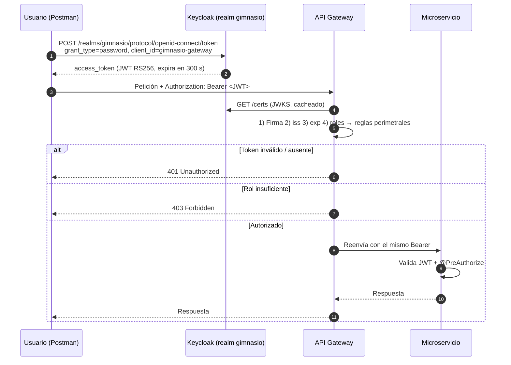

# 03 · Seguridad (Keycloak + JWT + RBAC)

---

## 1. Modelo de seguridad

El sistema usa **OAuth 2.0 / OpenID Connect** con **Keycloak** como proveedor de identidad. Todos los servicios con API REST actúan como **Resource Servers** que validan tokens JWT firmados con RS256.



**Capas de protección:**

1. **Perímetro (API Gateway):** `SecurityWebFilterChain` con reglas por método HTTP y ruta.
2. **Servicio (cada microservicio):** `SecurityFilterChain` + `@EnableMethodSecurity` + `@PreAuthorize` en cada endpoint.
3. **Dominio:** invariantes de agregados y Value Objects (rechazan datos inválidos aunque el usuario esté autorizado).

---

## 2. Configuración de Keycloak

El realm se importa automáticamente desde [`keycloak/realm/gimnasio-realm.json`](../keycloak/realm/gimnasio-realm.json) gracias a `start-dev --import-realm` en `docker-compose.yml`.

| Elemento | Valor |
|---|---|
| URL de administración | `http://localhost:8180` (usuario `admin` / clave `admin`) |
| Realm | `gimnasio` |
| Duración del access token | **300 s (5 min)** |
| Endpoint de token | `http://localhost:8180/realms/gimnasio/protocol/openid-connect/token` |
| JWKS | `http://localhost:8180/realms/gimnasio/protocol/openid-connect/certs` |

### 2.1 Roles del realm

| Rol | Descripción |
|---|---|
| `ROLE_ADMIN` | Administrador del gimnasio: acceso total |
| `ROLE_TRAINER` | Entrenador: gestiona clases, reporta averías, consulta miembros y monitoreo |
| `ROLE_MEMBER` | Socio: se inscribe, paga, consulta clases y registra entrenamientos |

### 2.2 Usuarios de prueba

| Usuario | Contraseña | Rol |
|---|---|---|
| `admin` | `admin123` | `ROLE_ADMIN` |
| `entrenador1` | `trainer123` | `ROLE_TRAINER` |
| `miembro1` | `member123` | `ROLE_MEMBER` |

### 2.3 Clientes

| Client ID | Tipo | Direct Access Grants | Uso |
|---|---|---|---|
| `gimnasio-gateway` | Público | ✅ | Cliente con el que se obtienen los tokens (Postman / curl) |
| `gimnasio-entrenador`, `gimnasio-equipo`, `gimnasio-miembro`, `gimnasio-clase`, `gimnasio-pago`, `gimnasio-notificacion`, `gimnasio-monitoreo` | Confidenciales | ❌ | Representan cada microservicio en el realm (preparados para *client credentials* entre servicios) |

### 2.4 Obtener tokens

```bash
get_token () {
  curl -s -X POST http://localhost:8180/realms/gimnasio/protocol/openid-connect/token \
    -d grant_type=password -d client_id=gimnasio-gateway \
    -d username="$1" -d password="$2" \
  | python3 -c "import sys,json; print(json.load(sys.stdin)['access_token'])"
}

ADMIN_TOKEN=$(get_token admin admin123)
TRAINER_TOKEN=$(get_token entrenador1 trainer123)
MEMBER_TOKEN=$(get_token miembro1 member123)
```

> En Postman, la carpeta **`seguridad (Keycloak & RBAC)` → `01. Obtención de Tokens`** guarda automáticamente `admin_token`, `trainer_token` y `member_token` en el entorno.

---

## 3. Configuración en los servicios

### 3.1 API Gateway (reactivo)

Ver detalle en [`02-API-GATEWAY.md` §6](02-API-GATEWAY.md#6-paso-3--seguridad-con-keycloak). Usa `@EnableWebFluxSecurity`, `ServerHttpSecurity` y `ReactiveJwtAuthenticationConverterAdapter`.

### 3.2 Microservicios (Servlet)

Cada microservicio (`miembro`, `entrenador`, `clase`, `equipo`, `pago`, `monitoreo`) tiene un `SecurityConfig` equivalente:

- `@EnableWebSecurity` + `@EnableMethodSecurity`.
- Sesión **stateless** y CSRF desactivado.
- Rutas públicas: Swagger (`/swagger-ui/**`, `/v3/api-docs/**`), consola H2 y Actuator.
- Conversor que lee `realm_access.roles` y antepone `ROLE_` si falta.
- Autorización fina con `@PreAuthorize("hasAnyRole(...)")` en los controladores.

```properties
spring.security.oauth2.resourceserver.jwt.issuer-uri=${KEYCLOAK_ISSUER_URI:http://localhost:8180/realms/gimnasio}
spring.security.oauth2.resourceserver.jwt.jwk-set-uri=${KEYCLOAK_JWK_SET_URI:http://localhost:8180/realms/gimnasio/protocol/openid-connect/certs}
```

`notificacion-service` no expone endpoints REST de negocio, por lo que no requiere configuración de Resource Server.

---

## 4. Matriz de permisos (RBAC)

La autorización **efectiva** de cada endpoint es la **intersección** entre la regla del Gateway y el `@PreAuthorize` del microservicio.

Leyenda: ✅ permitido · ❌ `403 Forbidden` · 🔓 público

### 4.1 Miembros (`/api/gimnasio/miembros`)

| Método y ruta | Regla Gateway | `@PreAuthorize` servicio | ADMIN | TRAINER | MEMBER |
|---|---|---|:-:|:-:|:-:|
| `POST /miembros` | ADMIN, MEMBER | ADMIN, MEMBER | ✅ | ❌ | ✅ |
| `GET /miembros` | ADMIN, TRAINER | ADMIN, TRAINER | ✅ | ✅ | ❌ |
| `GET /miembros/{id}` | ADMIN, TRAINER, MEMBER | ADMIN, TRAINER, MEMBER | ✅ | ✅ | ✅ |
| `POST /miembros/{id}/entrenamientos` | autenticado | ADMIN, TRAINER, MEMBER | ✅ | ✅ | ✅ |

### 4.2 Entrenadores (`/api/gimnasio/entrenadores`)

| Método y ruta | Regla Gateway | `@PreAuthorize` servicio | ADMIN | TRAINER | MEMBER |
|---|---|---|:-:|:-:|:-:|
| `POST /entrenadores` | ADMIN | ADMIN | ✅ | ❌ | ❌ |
| `GET /entrenadores` | autenticado | ADMIN, TRAINER, MEMBER | ✅ | ✅ | ✅ |
| `GET /entrenadores/{id}` | autenticado | ADMIN, TRAINER, MEMBER | ✅ | ✅ | ✅ |

### 4.3 Clases (`/api/gimnasio/clases`)

| Método y ruta | Regla Gateway | `@PreAuthorize` servicio | ADMIN | TRAINER | MEMBER |
|---|---|---|:-:|:-:|:-:|
| `POST /clases` | ADMIN, TRAINER | ADMIN, TRAINER | ✅ | ✅ | ❌ |
| `GET /clases` | ADMIN, TRAINER, MEMBER | ADMIN, TRAINER, MEMBER | ✅ | ✅ | ✅ |
| `PUT /clases/{id}/horario` | ADMIN, TRAINER | ADMIN, TRAINER | ✅ | ✅ | ❌ |
| `POST /clases/{id}/ingreso` | autenticado | ADMIN, TRAINER, MEMBER | ✅ | ✅ | ✅ |
| `POST /clases/{id}/salida` | autenticado | ADMIN, TRAINER, MEMBER | ✅ | ✅ | ✅ |

### 4.4 Equipos (`/api/gimnasio/equipos`)

| Método y ruta | Regla Gateway | `@PreAuthorize` servicio | ADMIN | TRAINER | MEMBER |
|---|---|---|:-:|:-:|:-:|
| `POST /equipos` | ADMIN, TRAINER | ADMIN | ✅ | ❌ | ❌ |
| `GET /equipos` | autenticado | ADMIN, TRAINER, MEMBER | ✅ | ✅ | ✅ |
| `POST /equipos/{id}/reportar-averia` | ADMIN, TRAINER | ADMIN, TRAINER | ✅ | ✅ | ❌ |

### 4.5 Pagos (`/api/gimnasio/pagos`)

| Método y ruta | Regla Gateway | `@PreAuthorize` servicio | ADMIN | TRAINER | MEMBER |
|---|---|---|:-:|:-:|:-:|
| `POST /pagos` | autenticado | ADMIN, MEMBER | ✅ | ❌ | ✅ |
| `GET /pagos` | ADMIN | ADMIN | ✅ | ❌ | ❌ |
| `GET /pagos/fallidos` | autenticado | ADMIN | ✅ | ❌ | ❌ |

### 4.6 Monitoreo (`/api/gimnasio/monitoreo`)

| Método y ruta | Regla Gateway | `@PreAuthorize` servicio | ADMIN | TRAINER | MEMBER |
|---|---|---|:-:|:-:|:-:|
| `GET /monitoreo/ocupacion` | ADMIN, TRAINER | ADMIN, TRAINER, MEMBER | ✅ | ✅ | ❌ |
| `GET /monitoreo/ocupacion/stream` (SSE) | ADMIN, TRAINER | ADMIN, TRAINER, MEMBER | ✅ | ✅ | ❌ |
| `GET /monitoreo/entrenamiento/{miembroId}/resumen` | ADMIN, TRAINER | ADMIN, TRAINER, MEMBER | ✅ | ✅ | ❌ |
| `GET /monitoreo/recuperacion/estado` | ADMIN, TRAINER | ADMIN | ✅ | ❌ | ❌ |

> [!NOTE]
> El Gateway es **más restrictivo** que `monitoreo-service` para `MEMBER`: a través del Gateway un socio no puede ver el monitoreo, aunque el servicio sí lo permitiría si se accediera directamente al puerto `8087`.

### 4.7 Gateway

| Método y ruta | ADMIN | TRAINER | MEMBER | Anónimo |
|---|:-:|:-:|:-:|:-:|
| `GET /api/gimnasio` | 🔓 | 🔓 | 🔓 | 🔓 |
| `GET /actuator/**` | 🔓 | 🔓 | 🔓 | 🔓 |
| `GET /agregacion/miembro/{id}` | ✅ (con pagos) | ✅ (pagos `[]`) | ✅ (pagos `[]`) | ❌ `401` |

---

## 5. Códigos de respuesta de seguridad

| Código | Cuándo ocurre | Ejemplo |
|---|---|---|
| `401 Unauthorized` | Sin header `Authorization`, token mal formado, firma inválida, `iss` incorrecto o token expirado | `curl http://localhost:8080/api/gimnasio/clases` |
| `403 Forbidden` | Token válido pero el rol no está autorizado | `MEMBER` → `GET /api/gimnasio/miembros` |
| `200 / 202` | Token válido y rol autorizado | `ADMIN` → `GET /api/gimnasio/clases` |

### Pruebas rápidas

```bash
# 401 - sin token
curl -i http://localhost:8080/api/gimnasio/clases

# 401 - token falso
curl -i -H "Authorization: Bearer token.invalido.123" http://localhost:8080/api/gimnasio/clases

# 403 - MEMBER listando miembros
curl -i -H "Authorization: Bearer $MEMBER_TOKEN" http://localhost:8080/api/gimnasio/miembros

# 403 - TRAINER creando entrenador
curl -i -X POST http://localhost:8080/api/gimnasio/entrenadores \
  -H "Authorization: Bearer $TRAINER_TOKEN" -H "Content-Type: application/json" \
  -d '{"nombre":"Pedro Gómez","especialidad":"Crossfit"}'

# 200 - ADMIN
curl -i -H "Authorization: Bearer $ADMIN_TOKEN" http://localhost:8080/api/gimnasio/clases
```

La colección de Postman incluye una suite completa (carpetas `02` a `05` de **`seguridad (Keycloak & RBAC)`**) con todas estas pruebas automatizadas.

---

## 6. Propagación del token entre servicios

| Origen → Destino | Mecanismo |
|---|---|
| Gateway → microservicios (rutas) | Spring Cloud Gateway reenvía el header `Authorization` original |
| Gateway → miembro / clase / pago (agregación) | `WebClient` añade explícitamente el header leído con `@RequestHeader` |
| `clase-service` → `entrenador-service` | `RestTemplate` con `HttpEntity` que copia el `Authorization` de la petición actual (`RequestContextHolder`) |

Se propaga el **token del usuario final** (no un token de servicio), de modo que el servicio destino aplica los permisos del usuario que originó la petición.

---

## 7. Buenas prácticas aplicadas y recomendaciones

| Aplicado | Recomendación para producción |
|---|---|
| Tokens de corta duración (5 min) | Usar refresh tokens en el cliente |
| Validación local de firma con JWKS (sin llamar a Keycloak por cada petición) | — |
| Defensa en profundidad (Gateway + servicio + dominio) | — |
| API stateless, CSRF desactivado | — |
| Credenciales de prueba en el realm versionado | Gestionar secretos con Vault / variables seguras; no versionar contraseñas |
| Keycloak en `start-dev` (HTTP) | Keycloak en modo producción con HTTPS y base de datos externa |
| Actuator y consola H2 abiertos | Restringirlos o deshabilitarlos |
