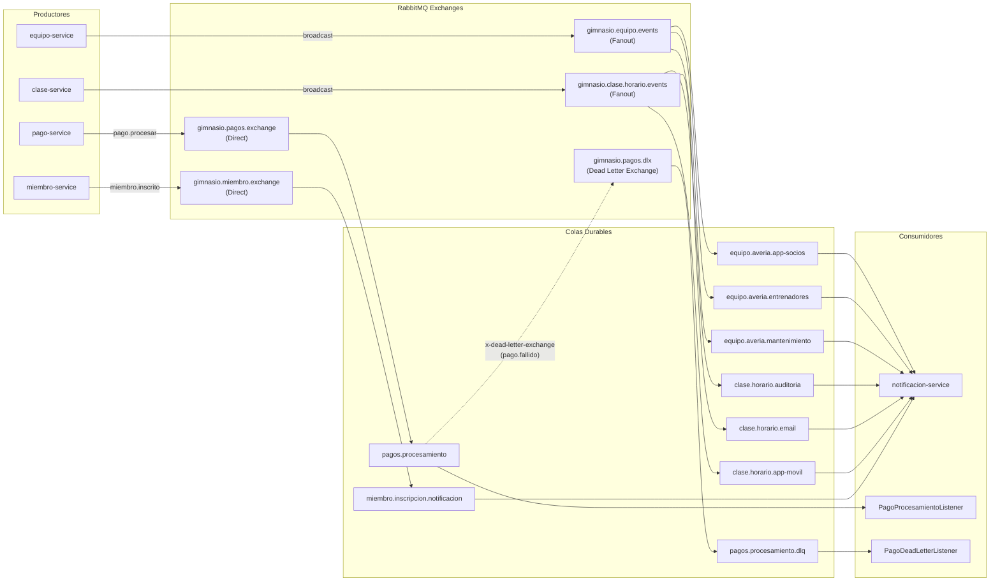
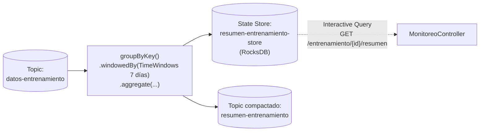

# 05 · Mensajería Asíncrona y Streaming (RabbitMQ + Kafka)

> El sistema utiliza **RabbitMQ** para comandos/eventos transaccionales de negocio (con enrutamiento Direct, Fanout Pub/Sub y Dead Letter Queue) y **Apache Kafka (modo KRaft)** para telemetría en tiempo real, **Kafka Streams** y recuperación ante fallos mediante checkpoints transaccionales.

---

## Parte I · RabbitMQ (Protocolo AMQP 0-9-1)

> Para la guía paso a paso de sustentación de RabbitMQ y DLQ, consulta también [`RABBITMQ_Y_DLQ_GUIA.md`](RABBITMQ_Y_DLQ_GUIA.md).

### 1. Topología completa en RabbitMQ

### 2. Escenario 1: Notificación de Inscripción (`DirectExchange`)
- **Productor:** [`MiembroService.java`](../services/miembro-microservice/src/main/java/co/analisys/gimnasio/service/MiembroService.java) publica `MiembroInscritoEvent` tras guardar al socio en H2.
- **Exchange:** `gimnasio.miembro.exchange` (`DirectExchange`) con routing key `miembro.inscrito`.
- **Cola:** `miembro.inscripcion.notificacion` (durable).
- **Consumidor:** [`MiembroInscripcionListener.java`](../services/notificacion-microservice/src/main/java/co/analisys/gimnasio/listener/MiembroInscripcionListener.java) en `notificacion-service`, que simula el envío del correo de bienvenida.

### 3. Escenario 2: Difusión Pub/Sub con `FanoutExchange` (1 evento → 3 colas)
El patrón Publish/Subscribe se implementa en dos dominios distintos:

#### A. Cambio de horario de clase (`gimnasio.clase.horario.events`)
- **Productor:** [`ClaseService.cambiarHorario(...)`](../services/clase-microservice/src/main/java/co/analisys/gimnasio/service/ClaseService.java) publica `HorarioClaseCambiadoEvent`.
- **Colas suscritas (sin routing key):**
  1. `clase.horario.app-movil` → notificación push a socios inscritos.
  2. `clase.horario.email` → correo electrónico con el nuevo horario.
  3. `clase.horario.auditoria` → registro de auditoría de reprogramaciones.
- **Consumidor:** [`ClaseHorarioListener.java`](../services/notificacion-microservice/src/main/java/co/analisys/gimnasio/listener/ClaseHorarioListener.java).

#### B. Reporte de avería de equipo (`gimnasio.equipo.events`)
- **Productor:** [`EquipoService.reportarAveria(...)`](../services/equipo-microservice/src/main/java/co/analisys/gimnasio/service/EquipoService.java) publica `EquipoAveriadoEvent`.
- **Colas suscritas:**
  1. `equipo.averia.mantenimiento` → orden de reparación para soporte técnico.
  2. `equipo.averia.entrenadores` → aviso a entrenadores para ajustar rutinas.
  3. `equipo.averia.app-socios` → aviso en la app móvil de máquina fuera de servicio.
- **Consumidor:** [`EquipoAveriaListener.java`](../services/notificacion-microservice/src/main/java/co/analisys/gimnasio/listener/EquipoAveriaListener.java).

### 4. Escenario 3: Pagos Asíncronos con Reintentos y Dead Letter Queue (DLQ)
Configurado en [`services/pago-microservice/src/main/java/co/analisys/gimnasio/config/RabbitMQConfig.java`](../services/pago-microservice/src/main/java/co/analisys/gimnasio/config/RabbitMQConfig.java):

| Parámetro | Valor | Explicación |
|---|---|---|
| Cola principal | `pagos.procesamiento` | Con argumentos `x-dead-letter-exchange = gimnasio.pagos.dlx` y `x-dead-letter-routing-key = pago.fallido` |
| Dead Letter Queue | `pagos.procesamiento.dlq` | Enlazada a `gimnasio.pagos.dlx` con routing key `pago.fallido` |
| `max-intentos` | `3` | Hasta 3 intentos para fallos transitorios (`PagoRechazadoException`) |
| Backoff exponencial | `1000 ms`, multiplicador `2.0` | Espera `1 s` tras el primer fallo y `2 s` tras el segundo |
| Excepción no reintentable | `PagoInvalidoException` (`false` en `SimpleRetryPolicy`) | Monto `<= 0` o datos inválidos van directo a la DLQ en el primer intento |
| Recoverer | `RejectAndDontRequeueRecoverer` | Envía `basic.reject(requeue=false)`, activando el enrutamiento nativo de RabbitMQ hacia el DLX |

---

## Parte II · Apache Kafka y Kafka Streams

### 1. Configuración del Broker y Topics
Kafka corre en **modo KRaft** (sin Zookeeper) en el contenedor `gimnasio-kafka`. Los topics se crean automáticamente con 3 particiones en [`KafkaTopicsConfig.java`](../services/monitoreo-microservice/src/main/java/co/analisys/gimnasio/config/KafkaTopicsConfig.java):

| Topic | Key | Particiones | Política de retención | Propósito |
|---|---|---|---|---|
| `ocupacion-clases` | `claseId` (`String`) | 3 | `7 días` (`delete`) | Eventos de ingreso/salida de clases en tiempo real |
| `datos-entrenamiento` | `miembroId` (`String`) | 3 | `30 días` (`delete`) | Sesiones de entrenamiento registradas por los socios |
| `resumen-entrenamiento` | `miembroId` (`String`) | 3 | `compact` (log compaction) | Salida agregada por Kafka Streams con el último resumen por miembro |

### 2. Ocupación de Clases en Tiempo Real (`ocupacion-clases` + SSE)
1. **Publicación post-commit:** En [`ClaseService.java`](../services/clase-microservice/src/main/java/co/analisys/gimnasio/service/ClaseService.java), los métodos `registrarIngreso` y `registrarSalida` usan `TransactionSynchronizationManager.registerSynchronization` (`afterCommit`) para publicar en Kafka **solo si la transacción en base de datos confirmó exitosamente**.
2. **Consumo y Dashboard:** [`OcupacionClaseConsumer.java`](../services/monitoreo-microservice/src/main/java/co/analisys/gimnasio/listener/OcupacionClaseConsumer.java) (`groupId = "monitoreo-grupo"`) actualiza el mapa concurrente en [`OcupacionDashboardService.java`](../services/monitoreo-microservice/src/main/java/co/analisys/gimnasio/service/OcupacionDashboardService.java) y notifica inmediatamente a todos los clientes conectados por **Server-Sent Events (`SseEmitter`)**.

### 3. Análisis Semanal con Kafka Streams (`datos-entrenamiento`)
Configurado en [`KafkaStreamsConfig.java`](../services/monitoreo-microservice/src/main/java/co/analisys/gimnasio/config/KafkaStreamsConfig.java):

- Agrupa los eventos por `miembroId` en **ventanas de 7 días sin gracia** (`TimeWindows.ofSizeWithNoGrace(Duration.ofDays(7))`).
- Acumula `totalSesiones`, `totalMinutos`, `totalCalorias` y un mapa `sesionesPorTipo` (`CARDIO`, `FUERZA`, `YOGA`, etc.).
- Materializa el estado en el store local `resumen-entrenamiento-store`, que [`ResumenEntrenamientoService.java`](../services/monitoreo-microservice/src/main/java/co/analisys/gimnasio/service/ResumenEntrenamientoService.java) consulta de forma interactiva.

### 4. Recuperación ante Fallos con Checkpoints Transaccionales
Implementado en [`RecuperacionService.java`](../services/monitoreo-microservice/src/main/java/co/analisys/gimnasio/service/RecuperacionService.java):

1. **Sin auto-commit en Kafka (`enable.auto.commit = false`):** La fuente de verdad del offset no es Kafka, sino la tabla `Checkpoint` en la base de datos H2 persistida en disco (`/data/monitoreo-db` en el volumen Docker `monitoreo-data`).
2. **Atomicidad (Evento + Offset en la misma transacción):** Por cada mensaje leído de `ocupacion-clases` o `datos-entrenamiento`, se guarda el registro en `EventoProcesado` (con restricción única `(topic, particion, offset_kafka)` para idempotencia) y se actualiza `Checkpoint.ultimoOffset` dentro de un mismo `TransactionTemplate.execute(...)`.
3. **Reanudación exacta (`ConsumerRebalanceListener.onPartitionsAssigned`):** Al iniciar o rebalancear el servicio, busca en la tabla `Checkpoint` el último offset procesado para cada `topic-particion` y ejecuta `consumer.seek(particion, checkpoint.getUltimoOffset() + 1)`. Así no se pierde ni se duplica ningún evento tras una caída del contenedor.
